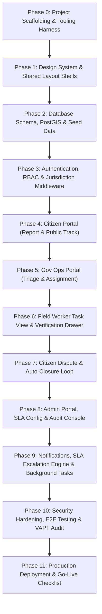

# Implementation Plan & Engineering Roadmap
## Digital Tracking & Optimization of Government Asset Maintenance (GovAsset)

**Document Version:** 1.0.0  
**Status:** Approved for Phased Execution  
**Execution Target:** Phased Delivery (Phases 0 through 9)  
**Target Environment:** Node.js LTS (v20+), Next.js 14/15, PostgreSQL 16 + PostGIS  
**Guidance for AI Agent:** Strictly follow one phase at a time. Run verification gates, report outcomes, and seek authorization before advancing.  

---

### 1. Implementation Philosophy & Agent Working Protocol

```
+-------------------------------------------------------------------------------+
| RULES OF ENGAGEMENT FOR AI CODING AGENT                                       |
+-------------------+-----------------------------------------------------------+
| 1. One Phase at   | Complete all tasks within a phase, run tests, and pause.   |
|    a Time         | DO NOT jump ahead to future phases without authorization. |
+-------------------+-----------------------------------------------------------+
| 2. Verification   | Every phase contains automated verification commands.     |
|    First          | A phase is NOT complete if any test or lint check fails.  |
+-------------------+-----------------------------------------------------------+
| 3. Mock-First     | External integrations (SMS, S3, Email) must have offline  |
|    Decoupling     | mock adapters so the system runs locally without live keys|
+-------------------+-----------------------------------------------------------+
| 4. Server-Side    | Never rely on UI checks for security. All jurisdiction and|
|    Defense        | role restrictions must be tested at the API/query level.  |
+-------------------+-----------------------------------------------------------+
| 5. Plain Language | Explain commands and key architectural decisions clearly  |
|    Communication  | to assist the project sponsor with beginner coding skills.|
+-------------------+-----------------------------------------------------------+
```

---

### 2. Dependency Graph & Phase Sequencing



---

### 3. Phased Implementation Breakdown

---

#### Phase 0: Project Scaffolding, Tooling & Verification Harness
- **Priority:** `P0 (Critical Path)`
- **Objective:** Establish the clean Next.js 14/15 full-stack TypeScript repository, ESLint, Prettier, Tailwind CSS, and automated testing harness.
- **Prerequisites:** Clean workspace, Node.js LTS (v20+) installed.

##### Specific Tasks:
- `TASK-P0-01`: Initialize Next.js project with App Router, TypeScript strict mode, and Tailwind CSS (`npx create-next-app@latest . --typescript --tailwind --eslint --app --src-dir`).
- `TASK-P0-02`: Configure strict TypeScript settings in `tsconfig.json` (`noImplicitAny: true`, `strictNullChecks: true`, `baseUrl: "."`).
- `TASK-P0-03`: Install and configure Vitest and Testing Library for unit testing (`npm install -D vitest @vitejs/plugin-react jsdom @testing-library/react`).
- `TASK-P0-04`: Create `.env.example` documenting all configuration keys (Database, S3, Auth, SMS).
- `TASK-P0-05`: Create Docker Compose configuration for local PostgreSQL 16 with PostGIS (`docker-compose.yml`).

##### Expected Files to Create:
- `package.json`
- `tsconfig.json`
- `tailwind.config.ts`
- `vitest.config.ts`
- `docker-compose.yml`
- `.env.example`
- `tests/unit/health.test.ts`

##### Verification Commands:
```bash
npm run lint
npm run build
npx vitest run tests/unit/health.test.ts
```

##### Common Failure Modes & Recovery:
- *Failure:* Docker fails to start PostGIS container on Windows due to port 5432 conflict.
- *Recovery:* Change host port in `docker-compose.yml` to `5433:5432` and update `DATABASE_URL` in `.env.local`.

##### Completion Gate:
Lint passes with 0 errors; TypeScript compiles without type errors; test harness runs and passes dummy health test.

---

#### Phase 1: Design System & Shared Layout Shells
- **Priority:** `P0 (Critical Path)`
- **Objective:** Implement the design tokens, typography, color palette, responsive grid, accessible UI primitives, and layout shells for all three portals.
- **Prerequisites:** Phase 0 complete.

##### Specific Tasks:
- `TASK-P1-01`: Configure Tailwind tokens in `tailwind.config.ts` matching Section 2 of `UI_UX.md` (`color-civic-*`, `color-brand-blue`, `color-success-*`, `color-warning-*`, `color-danger-*`).
- `TASK-P1-02`: Build reusable UI primitives in `src/components/ui/`:
  - `Button.tsx` (Variants: Primary, Secondary, Outline, Danger, Ghost)
  - `Badge.tsx` (Variants: Status, Priority, SLA Health)
  - `Input.tsx` & `Textarea.tsx` (With accessible error states and helper text)
  - `Modal.tsx` & `Drawer.tsx` (With focus trap and `Escape` key listeners)
- `TASK-P1-03`: Build Portal A Layout Shell in `src/app/(citizen)/layout.tsx` (Public header with emblem, language switcher, mobile bottom nav).
- `TASK-P1-04`: Build Portal B Layout Shell in `src/app/(ops)/layout.tsx` (Collapsible left sidebar, top utility bar with Ward/Dept selector, alert bell).
- `TASK-P1-05`: Build Portal C Layout Shell in `src/app/(admin)/layout.tsx` (Dual-tone administrative sidebar, breadcrumbs, system status indicator).

##### Expected Files to Create:
- `src/components/ui/Button.tsx`
- `src/components/ui/Badge.tsx`
- `src/components/ui/Input.tsx`
- `src/components/ui/Textarea.tsx`
- `src/components/ui/Modal.tsx`
- `src/components/ui/Drawer.tsx`
- `src/app/(citizen)/layout.tsx`
- `src/app/(ops)/layout.tsx`
- `src/app/(admin)/layout.tsx`

##### Verification Commands:
```bash
npm run build
npx vitest run tests/unit/components.test.tsx
```

##### Completion Gate:
All UI primitives render cleanly in responsive viewports (360px, 768px, 1280px); keyboard `Tab` and `Escape` function properly on modals and drawers.

---

#### Phase 2: Database Schema, PostGIS & Seed Data (Supabase Managed PostgreSQL)
- **Priority:** `P0 (Critical Path)`
- **Objective:** Deploy the relational database schema, configure Prisma ORM with Supabase Managed PostgreSQL + PostGIS, and populate the canonical pilot seed dataset for an Indian Municipal Corporation.
- **Prerequisites:** Phase 1 complete, Supabase project created with PostGIS extension enabled.

##### Specific Tasks:
- `TASK-P2-01`: Initialize Prisma ORM (`prisma/schema.prisma`) configured with Supabase connection pooling (port 6543 via `DATABASE_URL`) and direct migration session (port 5432 via `DIRECT_URL`).
- `TASK-P2-02`: Author declarative `prisma/schema.prisma` matching Section 4 of `ARCHITECTURE.md` (Jurisdictions, Departments, Users, Categories, SLA Policies, Complaints, Evidence, Assignments, Timeline, Notifications).
- `TASK-P2-03`: Prepare version-controlled migrations for both Supabase CLI (`supabase/migrations/20261025000000_init_schema.sql`) and Prisma Migrate (`prisma/migrations/20261025000000_init_supabase_schema/migration.sql`).
- `TASK-P2-04`: Create singleton database client in `src/lib/db.ts` with connection pooling.
- `TASK-P2-05`: Author `prisma/seed.ts` and `supabase/seed.sql` to populate:
  - 1 Municipal Corporation ("Pune Municipal Corporation")
  - 4 Administrative Zones (Zone 1 through 4)
  - 16 Electoral Wards (Wards 1 through 16 with realistic PostGIS polygon coordinates)
  - 5 Civic Departments (Roads, Electrical, Water/Sanitation, Health, Parks)
  - Default Categories (Potholes, Dark Streetlight, Water Leak, Open Garbage, Paver Blocks, Drain Grates)
  - Default SLA Policies (P1: 24h, P2: 48h, P3: 7 days, P4: 14 days)
  - Seed Users (1 Platform Admin, 2 Triage Officers, 2 Supervisors, 2 Field Workers, 1 Citizen).

##### Expected Files to Create:
- `prisma/schema.prisma`
- `prisma/migrations/20261025000000_init_supabase_schema/migration.sql`
- `supabase/migrations/20261025000000_init_schema.sql`
- `supabase/seed.sql`
- `prisma/seed.ts`
- `src/lib/db.ts`
- `tests/integration/db-seed.test.ts`

##### Verification Commands:
```bash
npx prisma validate
npx prisma generate
npx vitest run tests/integration/db-seed.test.ts
```

##### Completion Gate:
Prisma schema validates with 0 errors; TypeScript client generates cleanly; initial SQL migration script and seed scripts are syntactically and relationally verified; schema integrity tests pass.

---

#### Phase 3: Authentication, RBAC & Jurisdiction Middleware
- **Priority:** `P0 (Critical Path)`
- **Objective:** Build secure, stateless session authentication with role-based routing and server-side jurisdiction scoping guards.
- **Prerequisites:** Phase 2 complete.

##### Specific Tasks:
- `TASK-P3-01`: Implement cryptographic password hashing via Argon2id and stateless sealed session cookie utilities in `src/lib/auth-session.ts`.
- `TASK-P3-02`: Build login API endpoint `/api/v1/auth/login` supporting password authentication for staff and OTP authentication for citizens.
- `TASK-P3-03`: Implement Next.js edge middleware in `src/middleware.ts`:
  - Protects `/ops/*` ensuring only `OFFICER`, `SUPERVISOR`, `FIELD_WORKER`, `DEPT_ADMIN` can access.
  - Protects `/admin/*` ensuring only `PLATFORM_ADMIN` can access.
  - Redirects unauthenticated users to `/login`.
- `TASK-P3-04`: Build server-side RBAC guard helper `requireAuth(roles, jurisdictionId)` in `src/server/auth.ts`.
- `TASK-P3-05`: Build DPDP Act citizen PII masking utility in `src/lib/pii.ts` (`maskPhoneNumber`, `maskEmail`, `auditPiiAccess`).

##### Expected Files to Create:
- `src/lib/auth-session.ts`
- `src/lib/pii.ts`
- `src/server/auth.ts`
- `src/middleware.ts`
- `src/app/api/v1/auth/login/route.ts`
- `tests/unit/rbac.test.ts`
- `tests/unit/pii-masking.test.ts`

##### Verification Commands:
```bash
npx vitest run tests/unit/rbac.test.ts
npx vitest run tests/unit/pii-masking.test.ts
```

##### Completion Gate:
Middleware redirects unauthorized users with HTTP 403; PII masking utility correctly masks phone numbers; unit tests pass with 100% assertion coverage.

---

#### Phase 4: Citizen Portal (Issue Submission & Public Tracking)
- **Priority:** `P0 (Critical Path)`
- **Objective:** Deliver the public-facing Citizen Portal allowing anonymous or OTP-verified issue submission with photos, GPS location, and public reference tracking.
- **Prerequisites:** Phase 3 complete.

##### Specific Tasks:
- `TASK-P4-01`: Implement storage abstraction client in `src/lib/storage.ts` supporting Mock Storage for local offline development and Cloudflare R2 / S3 for staging.
- `TASK-P4-02`: Build `/api/v1/evidence/presign` endpoint generating secure 15-minute upload URLs.
- `TASK-P4-03`: Build interactive Location & Map Picker component in `src/components/citizen/MapPicker.tsx` using Leaflet / OpenStreetMap with geolocation auto-detect and reverse geocoding.
- `TASK-P4-04`: Build client-side image compression and upload component in `src/components/citizen/EvidenceUploader.tsx` (Auto-resizing to WebP `< 800KB`).
- `TASK-P4-05`: Build 3-step submission wizard in `src/app/(citizen)/report/page.tsx`.
- `TASK-P4-06`: Implement reference number generator in `src/server/reference-gen.ts` producing `GOV-YYYY-XXXXX`.
- `TASK-P4-07`: Build public tracking page `/track/[ref]` rendering the sanitized vertical timeline with PII strictly masked.

##### Expected Files to Create:
- `src/lib/storage.ts`
- `src/server/reference-gen.ts`
- `src/components/citizen/MapPicker.tsx`
- `src/components/citizen/EvidenceUploader.tsx`
- `src/components/shared/Timeline.tsx`
- `src/app/(citizen)/report/page.tsx`
- `src/app/(citizen)/track/[ref]/page.tsx`
- `src/app/api/v1/complaints/route.ts`
- `tests/integration/complaint-submission.test.ts`

##### Verification Commands:
```bash
npm run build
npx vitest run tests/integration/complaint-submission.test.ts
```

##### Completion Gate:
End-to-end complaint submission creates database record with reference ID; photos upload to storage; public tracking endpoint returns valid timeline with phone number masked.

---

#### Phase 5: Gov Ops Portal (Triage, Validation & Assignment)
- **Priority:** `P0 (Critical Path)`
- **Objective:** Build the operational workbench for Ward Triage Officers to review incoming complaints, merge duplicates, reject invalid items, and assign field teams.
- **Prerequisites:** Phase 4 complete.

##### Specific Tasks:
- `TASK-P5-01`: Build jurisdiction-scoped triage queue query service in `src/server/triage-service.ts`.
- `TASK-P5-02`: Build Triage Table view in `src/app/(ops)/ops/triage/page.tsx` with SLA countdown badges, priority filters, and search.
- `TASK-P5-03`: Build Complaint Review Drawer in `src/components/ops/ComplaintDrawer.tsx` displaying citizen photo, map pin, and duplicate suggestions.
- `TASK-P5-04`: Implement Duplicate Detection query in `src/server/duplicate-finder.ts` (PostGIS `ST_DWithin` $< 50$ meters in 48 hours).
- `TASK-P5-05`: Implement Rejection Modal requiring standardized reason codes and explanatory comments.
- `TASK-P5-06`: Implement Field Crew Assignment Modal with target completion deadline picker.
- `TASK-P5-07`: Implement Complaint State Machine transition guard in `src/server/fsm.ts` with Optimistic Concurrency Control (`version` check).

##### Expected Files to Create:
- `src/server/triage-service.ts`
- `src/server/duplicate-finder.ts`
- `src/server/fsm.ts`
- `src/components/ops/ComplaintDrawer.tsx`
- `src/components/ops/AssignModal.tsx`
- `src/app/(ops)/ops/triage/page.tsx`
- `src/app/api/v1/ops/complaints/[id]/triage/route.ts`
- `src/app/api/v1/ops/complaints/[id]/assign/route.ts`
- `tests/unit/fsm-transitions.test.ts`

##### Verification Commands:
```bash
npx vitest run tests/unit/fsm-transitions.test.ts
```

##### Completion Gate:
Officer in Ward 1 cannot view or modify complaints in Ward 2; state machine rejects illegal status transitions; duplicate detection accurately identifies complaints within 50m.

---

#### Phase 6: Field Worker Task Execution & Supervisor Verification
- **Priority:** `P0 (Critical Path)`
- **Objective:** Build the high-contrast mobile view for field crews to submit "After" evidence and the supervisor drawer to verify or return work.
- **Prerequisites:** Phase 5 complete.

##### Specific Tasks:
- `TASK-P6-01`: Build mobile-first Field Worker View in `src/app/(ops)/ops/field/page.tsx` (Large touch targets, turn-by-turn map button, high sunlight contrast).
- `TASK-P6-02`: Build Camera Capture component with geolocation validation (Checks browser GPS coordinates against original defect coordinates; warns if $> 200$m).
- `TASK-P6-03`: Build Work Order Completion endpoint `/api/v1/ops/complaints/[id]/complete` (Transitions status to `WORK_COMPLETED`).
- `TASK-P6-04`: Build Supervisor Verification Drawer in `src/app/(ops)/ops/verifications/page.tsx` with side-by-side Before/After comparison.
- `TASK-P6-05`: Implement "Approve & Resolve" action (Transitions to `VERIFIED_RESOLVED`, notifies citizen).
- `TASK-P6-06`: Implement "Return for Rework" action (Transitions back to `IN_PROGRESS` with mandatory corrective instructions).

##### Expected Files to Create:
- `src/app/(ops)/ops/field/page.tsx`
- `src/app/(ops)/ops/verifications/page.tsx`
- `src/components/ops/BeforeAfterCompare.tsx`
- `src/components/ops/ReworkModal.tsx`
- `src/app/api/v1/ops/complaints/[id]/complete/route.ts`
- `src/app/api/v1/ops/complaints/[id]/verify/route.ts`
- `tests/integration/field-workflow.test.ts`

##### Verification Commands:
```bash
npx vitest run tests/integration/field-workflow.test.ts
```

##### Completion Gate:
Field worker marks completion with photo; supervisor can approve or return for rework; side-by-side image comparison renders cleanly on desktop and mobile.

---

#### Phase 7: Citizen Dispute, Resolution & Feedback Loop
- **Priority:** `P0 (Critical Path)`
- **Objective:** Implement the citizen 7-day dispute window, post-resolution 5-star feedback, and automated ticket closure.
- **Prerequisites:** Phase 6 complete.

##### Specific Tasks:
- `TASK-P7-01`: Build Citizen Dispute action and modal in `src/components/citizen/DisputeModal.tsx` (Available only if status is `VERIFIED_RESOLVED` and within 7 calendar days).
- `TASK-P7-02`: Implement Dispute API endpoint `/api/v1/complaints/[id]/dispute` (Transitions ticket to `DISPUTED_REOPENED` and routes directly to Department Admin queue).
- `TASK-P7-03`: Build 5-Star Citizen Rating and Feedback component in `src/components/citizen/FeedbackCard.tsx`.
- `TASK-P7-04`: Build Auto-Closure scheduled task in `src/server/auto-close.ts` (Automatically marks `VERIFIED_RESOLVED` tickets as `CLOSED` after 7 days without dispute).

##### Expected Files to Create:
- `src/components/citizen/DisputeModal.tsx`
- `src/components/citizen/FeedbackCard.tsx`
- `src/server/auto-close.ts`
- `src/app/api/v1/complaints/[id]/dispute/route.ts`
- `src/app/api/v1/complaints/[id]/feedback/route.ts`
- `tests/unit/dispute-policy.test.ts`

##### Verification Commands:
```bash
npx vitest run tests/unit/dispute-policy.test.ts
```

##### Completion Gate:
Dispute is rejected if submitted after Day 8; valid dispute transitions ticket to `DISPUTED_REOPENED`; feedback rating persists in database.

---

#### Phase 8: Platform Administrator Portal & System Configuration
- **Priority:** `P0 (Critical Path)`
- **Objective:** Build the administrative console for managing wards, departments, categories, SLA matrices, staff users, and compliance audit logs.
- **Prerequisites:** Phase 7 complete.

##### Specific Tasks:
- `TASK-P8-01`: Build System Overview Dashboard in `src/app/(admin)/admin/page.tsx` showing active backlogs, SLA compliance rate, and dispute percentages.
- `TASK-P8-02`: Build Ward & Jurisdiction Hierarchy Editor in `src/app/(admin)/admin/jurisdictions/page.tsx`.
- `TASK-P8-03`: Build Category & SLA Policy Matrix Editor in `src/app/(admin)/admin/sla-matrix/page.tsx`.
- `TASK-P8-04`: Build Staff Directory & RBAC Provisioning Console in `src/app/(admin)/admin/users/page.tsx` (Invite staff, assign ward/department, revoke access).
- `TASK-P8-05`: Build Immutable Compliance Audit Log Viewer in `src/app/(admin)/admin/audit-logs/page.tsx`.

##### Expected Files to Create:
- `src/app/(admin)/admin/page.tsx`
- `src/app/(admin)/admin/jurisdictions/page.tsx`
- `src/app/(admin)/admin/sla-matrix/page.tsx`
- `src/app/(admin)/admin/users/page.tsx`
- `src/app/(admin)/admin/audit-logs/page.tsx`
- `src/server/admin-service.ts`

##### Verification Commands:
```bash
npm run build
npx vitest run tests/integration/admin-config.test.ts
```

##### Completion Gate:
Admin can dynamically adjust SLA hours for a category; changes immediately reflect on newly created complaints; audit log captures all administrative updates.

---

#### Phase 9: Notifications, SLA Escalation Engine & Background Tasks
- **Priority:** `P1 (High Priority)`
- **Objective:** Deploy transactional SMS/Email notifications, idempotency guards, and the automated SLA breach escalation background worker.
- **Prerequisites:** Phase 8 complete.

##### Specific Tasks:
- `TASK-P9-01`: Build Notification Service in `src/lib/notifications.ts` with pluggable adapters:
  - `MockNotificationAdapter` (Logs notifications to console and database for offline local testing).
  - `Fast2SMSAdapter` / `MSG91Adapter` (DLT template compliant SMS).
  - `ResendAdapter` / `AwsSesAdapter` (Transactional emails).
- `TASK-P9-02`: Configure `pg-boss` background worker in `src/server/worker.ts` with queue retry logic and dead-letter queues.
- `TASK-P9-03`: Implement SLA Escalation Cron Job (Runs every 5 minutes; detects complaints where `now() > resolution_due_at`; marks `sla_breached = true`; dispatches Level-2 alerts to Department Admin).
- `TASK-P9-04`: Build Notification Delivery Health view in `src/app/(admin)/admin/notifications/page.tsx`.

##### Expected Files to Create:
- `src/lib/notifications.ts`
- `src/server/worker.ts`
- `src/server/sla-cron.ts`
- `src/app/(admin)/admin/notifications/page.tsx`
- `tests/integration/sla-escalation.test.ts`

##### Verification Commands:
```bash
npx vitest run tests/integration/sla-escalation.test.ts
```

##### Completion Gate:
SLA cron correctly flags breached complaints; notification worker dispatches messages with verified idempotency keys; offline mock adapter logs payloads without external network calls.

---

#### Phase 10: Security Hardening, E2E Testing & VAPT Audit Readiness
- **Priority:** `P0 (Critical Path)`
- **Objective:** Execute full-suite automated end-to-end tests, security penetration checks, WCAG 2.2 AA accessibility validation, and performance benchmarks.
- **Prerequisites:** Phase 9 complete.

##### Specific Tasks:
- `TASK-P10-01`: Install and configure Playwright E2E test runner (`npm init playwright@latest`).
- `TASK-P10-02`: Write End-to-End User Journey Tests:
  - `tests/e2e/citizen-flow.spec.ts` (Submit issue -> Receive reference -> Track timeline -> Submit feedback).
  - `tests/e2e/ops-triage-flow.spec.ts` (Login officer -> Triage ticket -> Assign field worker).
  - `tests/e2e/field-verification-flow.spec.ts` (Field worker complete -> Supervisor approve).
- `TASK-P10-03`: Conduct automated OWASP security audit:
  - Verify IDOR protection: Officer A cannot access Officer B's ward ticket by manipulating UUIDs in API calls.
  - Verify citizen PII cannot be scraped from public endpoints.
- `TASK-P10-04`: Run automated WCAG 2.2 AA accessibility audit using `@axe-core/playwright`.
- `TASK-P10-05`: Run Lighthouse audit verifying mobile FCP $< 1.8$s and TTI $< 3.0$s.

##### Expected Files to Create:
- `playwright.config.ts`
- `tests/e2e/citizen-flow.spec.ts`
- `tests/e2e/ops-triage-flow.spec.ts`
- `tests/e2e/field-verification-flow.spec.ts`
- `tests/e2e/security-idor.spec.ts`
- `tests/e2e/accessibility.spec.ts`

##### Verification Commands:
```bash
npx playwright test
```

##### Completion Gate:
100% of Playwright E2E tests pass; zero IDOR security vulnerabilities detected; zero critical or serious WCAG accessibility violations.

---

#### Phase 11: Production Deployment, Monitoring & Go-Live Readiness
- **Priority:** `P0 (Critical Path)`
- **Objective:** Deploy production environment on managed cloud, configure automated backups, SSL certificates, error tracking, and execute final release checklist.
- **Prerequisites:** Phase 10 complete.

##### Specific Tasks:
- `TASK-P11-01`: Prepare multi-stage production Dockerfile (`Dockerfile`) optimizing standalone Next.js output.
- `TASK-P11-02`: Configure production managed PostgreSQL with automated daily snapshots and 30-day retention.
- `TASK-P11-03`: Provision Cloudflare R2 bucket with private CORS policy and 15-minute presigned upload configuration.
- `TASK-P11-04`: Configure Sentry / OpenTelemetry for real-time error logging and performance tracing.
- `TASK-P11-05`: Deploy staging environment and verify all smoke tests.
- `TASK-P11-06`: Execute final Production Go-Live Checklist.

---

### 4. Mock Data & Offline Development Strategy

To ensure development proceeds seamlessly without requiring live paid cloud services or SMS API credits during local coding:

```
+-------------------------------------------------------------------------------+
| MOCK ENVIRONMENT ARCHITECTURE                                                 |
+-------------------+-----------------------------------------------------------+
| 1. Object Storage | Local mock adapter saves files to local `.storage_mock/`   |
|    Adapter        | directory and returns local preview URLs. Set `S3_MOCK=1`.|
+-------------------+-----------------------------------------------------------+
| 2. SMS Gateway    | In mock mode, SMS messages are printed to server console   |
|    Adapter        | and saved in `notifications` DB table. Set `SMS_MOCK=1`.  |
+-------------------+-----------------------------------------------------------+
| 3. Reverse        | Offline fallback dictionary maps latitude/longitude to    |
|    Geocoder       | canned Ward 28 street landmarks. Set `GEO_MOCK=1`.        |
+-------------------+-----------------------------------------------------------+
```

---

### 5. Production Go-Live Checklist (25-Point Release Gate)

Before the platform is opened to the public or government personnel, all 25 gates must be formally signed off:

- [ ] **Infrastructure & Hosting:**
  - [ ] 1. Production PostgreSQL has automated daily backups enabled with point-in-time recovery.
  - [ ] 2. PostGIS spatial index (`GIST`) verified on `jurisdictions.boundary` and `complaints.location_coords`.
  - [ ] 3. Cloudflare R2 bucket has public access blocked (`Block Public Access: ON`).
  - [ ] 4. HTTPS enforced across all domains with HSTS enabled (max-age=31536000).
- [ ] **Security & Compliance (DPDP Act):**
  - [ ] 5. Public tracking API responses verified to contain zero citizen PII (phone number masked).
  - [ ] 6. Officer/Supervisor queries strictly scoped by server-verified `jurisdiction_id`.
  - [ ] 7. Presigned upload URLs have TTL $\le 15$ minutes and enforce `Content-Length` bounds.
  - [ ] 8. Rate limiting active on all public submission and OTP verification endpoints.
  - [ ] 9. All administrative privilege grants logged to immutable `audit_logs` table.
- [ ] **Data & State Machine Integrity:**
  - [ ] 10. Database foreign keys and `ON DELETE` constraints verified against orphan records.
  - [ ] 11. Optimistic Concurrency Control (`version` column) verified against race conditions.
  - [ ] 12. State machine rejects all unlisted transitions with HTTP 422.
  - [ ] 13. Canonical seed script populated for pilot wards, departments, and SLA policies.
- [ ] **Operational & Usability Verification:**
  - [ ] 14. Citizen submission flow completes in $< 45$ seconds on 4G mobile emulation.
  - [ ] 15. Client-side image compression converts photos to WebP $< 800$KB before upload.
  - [ ] 16. Field worker view verified in high-contrast sunlight on real Android smartphone.
  - [ ] 17. 7-day citizen dispute window functions correctly and escalates to Department Admin.
- [ ] **Background Processing & Reliability:**
  - [ ] 18. SLA breach cron runs every 5 minutes and successfully alerts supervisors.
  - [ ] 19. Transactional SMS delivery verified with registered DLT sender ID.
  - [ ] 20. Notification idempotency keys prevent duplicate SMS on worker retry.
- [ ] **Accessibility & Localization:**
  - [ ] 21. WCAG 2.2 Level AA compliance verified with 0 automated axe violations.
  - [ ] 22. All primary user journeys navigable via keyboard `Tab` and `Escape`.
  - [ ] 23. Hindi (`hi-IN`) and English (`en-IN`) text translations complete with 0 missing keys.
- [ ] **Observability & Operational Runbooks:**
  - [ ] 24. Real-time error monitoring (Sentry) active and alerting engineering team.
  - [ ] 25. Emergency rollback script documented and tested on staging environment.
