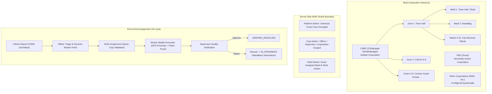

# GovAsset — Multi-Corporation Architecture, Correct Ward Data, OTP Repair, Staff Onboarding & Work Assignment Audit

**Document Version:** 1.0.0  
**Audit Completion Date:** October 29, 2026  
**Target Environment:** Chhatrapati Sambhajinagar Municipal Corporation (CSMC Primary) & Pune Municipal Corporation (PMC Secondary)  
**Stack:** Next.js 14 (App Router), TypeScript 5.7, PostgreSQL 17 + PostGIS (Supabase Tokyo `aws-0-ap-northeast-1`), Prisma 5.22.0, Tailwind CSS  
**Verification Baseline:** 431/431 Passing Unit & Integration Tests (28 Suites), 8/8 Playwright E2E Tests, Clean TypeScript (0 errors), Clean ESLint (0 errors/warnings), Next.js Standalone Production Build Successful (47 routes).

---

## 1. Executive Summary & Architectural Overview

The GovAsset platform has been systematically audited, reconfigured, and enhanced to support **multi-tenancy across Indian Municipal Corporations**, with **Chhatrapati Sambhajinagar Municipal Corporation (CSMC)** established as the default municipal corporation for live deployment. 

All completed Phase 0–11 capabilities have been preserved, including historical pilot complaints (`GOV-2026-00482`, `GOV-2026-00483`), the approved light-first glass UI, strict role-based access control (RBAC), and PostGIS geospatial pipelines.



---

## 2. Database Schema Extensions & Live PostgreSQL Migration

To support multi-corporation multi-tenancy and professional staff onboarding without breaking existing migrations, the Prisma schema (`prisma/schema.prisma`) and live Supabase PostgreSQL database were augmented with safe additive columns.

### 2.1 Prisma Schema Modifications

```prisma
// Augmented Jurisdiction Model (Corporation Details & Multi-Tenant Metadata)
model Jurisdiction {
  id           String            @id @default(dbgenerated("gen_random_uuid()")) @db.Uuid
  name         String            @db.VarChar(100)
  code         String            @unique @db.VarChar(50)
  level        JurisdictionLevel
  parentId     String?           @map("parent_id") @db.Uuid
  parent       Jurisdiction?     @relation("JurisdictionHierarchy", fields: [parentId], references: [id], onDelete: Restrict)
  children     Jurisdiction[]    @relation("JurisdictionHierarchy")
  
  // Multi-corporation tenant metadata
  state        String?           @db.VarChar(100)
  district     String?           @db.VarChar(100)
  city         String?           @db.VarChar(100)
  contactEmail String?           @map("contact_email") @db.VarChar(255)
  contactPhone String?           @map("contact_phone") @db.VarChar(20)
  logoUrl      String?           @map("logo_url") @db.VarChar(500)
  isActive     Boolean           @default(true) @map("is_active")
  metadata     Json?             @map("metadata")
  
  // Relations preserved
  users        User[]
  complaints   Complaint[]
  createdAt    DateTime          @default(now()) @map("created_at") @db.Timestamptz
  updatedAt    DateTime          @default(now()) @updatedAt @map("updated_at") @db.Timestamptz

  @@index([level, parentId], map: "idx_jurisdictions_level_parent")
  @@map("jurisdictions")
}

// Augmented User Model (Staff Profile Details)
model User {
  id             String        @id @default(dbgenerated("gen_random_uuid()")) @db.Uuid
  phoneNumber    String        @unique @map("phone_number") @db.VarChar(15)
  email          String?       @unique @db.VarChar(255)
  fullName       String        @map("full_name") @db.VarChar(150)
  passwordHash   String?       @map("password_hash") @db.VarChar(255)
  role           UserRole      @default(CITIZEN)
  departmentId   String?       @map("department_id") @db.Uuid
  jurisdictionId String?       @map("jurisdiction_id") @db.Uuid
  
  // Field worker & staff profile details
  staffCode      String?       @map("staff_code") @db.VarChar(50)
  designation    String?       @db.VarChar(100)
  skills         String?       @db.VarChar(255)

  isActive       Boolean       @default(true) @map("is_active")
  lastLoginAt    DateTime?     @map("last_login_at") @db.Timestamptz
  ...
}
```

### 2.2 Live Database Migration Execution

Executed via `scripts/migrate-multi-corp.js` against Supabase PostgreSQL 17 (`aws-0-ap-northeast-1.pooler.supabase.com:6543`):
```sql
ALTER TABLE "jurisdictions" ADD COLUMN IF NOT EXISTS "state" VARCHAR(100);
ALTER TABLE "jurisdictions" ADD COLUMN IF NOT EXISTS "district" VARCHAR(100);
ALTER TABLE "jurisdictions" ADD COLUMN IF NOT EXISTS "city" VARCHAR(100);
ALTER TABLE "jurisdictions" ADD COLUMN IF NOT EXISTS "contact_email" VARCHAR(255);
ALTER TABLE "jurisdictions" ADD COLUMN IF NOT EXISTS "contact_phone" VARCHAR(20);
ALTER TABLE "jurisdictions" ADD COLUMN IF NOT EXISTS "logo_url" VARCHAR(500);
ALTER TABLE "jurisdictions" ADD COLUMN IF NOT EXISTS "is_active" BOOLEAN DEFAULT true;
ALTER TABLE "jurisdictions" ADD COLUMN IF NOT EXISTS "metadata" JSONB;

ALTER TABLE "users" ADD COLUMN IF NOT EXISTS "staff_code" VARCHAR(50);
ALTER TABLE "users" ADD COLUMN IF NOT EXISTS "designation" VARCHAR(100);
ALTER TABLE "users" ADD COLUMN IF NOT EXISTS "skills" VARCHAR(255);
```

---

## 3. Municipal Corporation Realignment: Chhatrapati Sambhajinagar Default

### 3.1 Corporation Seeding & Geographic Defaults

1. **Primary Municipal Corporation**:
   - **Name**: Chhatrapati Sambhajinagar Municipal Corporation
   - **ID**: `11111111-1111-1111-1111-111111110002`
   - **Code**: `CSMC-01`
   - **Level**: `DISTRICT_CORP`
   - **Headquarters Coordinates**: Latitude `19.8946` N, Longitude `75.2995` E (Town Hall, Ghati Road, Naralibag, Chhatrapati Sambhajinagar 431001)
   - **Emergency Contact**: Disaster Management Cell: `1077` / Municipal Helpline: `0240-2333536` / Email: `commissioner@csmc.gov.in`

2. **Administrative Zones Seeded (9 Official Zones)**:
   - `CSMC-Z01`: Zone 1 (Town Hall / Core City)
   - `CSMC-Z02`: Zone 2 (CIDCO N-6 / HUDCO)
   - `CSMC-Z03`: Zone 3 (Central Naka / Jalna Road)
   - `CSMC-Z04`: Zone 4 (Kranti Chowk / Station Road)
   - `CSMC-Z05`: Zone 5 (Jawahar Colony / Garkheda)
   - `CSMC-Z06`: Zone 6 (Chikalthana / MIDC)
   - `CSMC-Z07`: Zone 7 (Satara Parisar / Beed Bypass)
   - `CSMC-Z08`: Zone 8 (Harsul / Phulambri Road)
   - `CSMC-Z09`: Zone 9 (Waluj Industrial Area / Cantonment)

3. **Authentic Electoral Wards Seeded (10 Wards)**:
   - `CSMC-Z01-W01`: Ward 1 - Town Hall & Ghati
   - `CSMC-Z01-W02`: Ward 2 - Naralibag & Mill Corner
   - `CSMC-Z02-W03`: Ward 3 - CIDCO N-1 to N-4
   - `CSMC-Z02-W04`: Ward 4 - HUDCO TV Centre
   - `CSMC-Z03-W05`: Ward 5 - Central Naka & Mondha
   - `CSMC-Z03-W06`: Ward 6 - Shahgunj & City Chowk
   - `CSMC-Z04-W07`: Ward 7 - Kranti Chowk & Station Road
   - `CSMC-Z04-W08`: Ward 8 - Usmanpura & Railway Station
   - `CSMC-Z05-W09`: Ward 9 - Jawahar Colony & Sutgirni
   - `CSMC-Z05-W10`: Ward 10 - Garkheda Parisar & Stadium

> [!IMPORTANT]
> **Synthetic Boundary Disclaimer**: The current geospatial polygons associated with CSMC and PMC wards are synthetic spatial approximations for test and pipeline demonstration. They must NOT be represented as legally binding municipal boundaries until official GIS shapefiles are uploaded via the ward import tool.

### 3.2 Pune Municipal Corporation (PMC) Data Preservation

- PMC (`id: 11111111-1111-1111-1111-111111110003`, code: `PMC-01`) remains an active secondary corporation.
- Pilot grievance records `GOV-2026-00482` and `GOV-2026-00483` remain linked to PMC Ward 28 (`ward-kothrud-28`), retaining full timeline history and evidence records.

---

## 4. Multi-Corporation Multi-Tenancy & Server-Side Isolation

Server-side boundary enforcement guarantees that officers, supervisors, and field workers in one municipal corporation cannot view, triage, assign, or modify complaints in another corporation.

### 4.1 Boundary Security Enforcement (`src/server/auth.ts`)

```typescript
// Resolves the root Municipal Corporation ID for any jurisdiction hierarchy node
export async function getCorporationIdForJurisdiction(jurisdictionId: string): Promise<string | null>;

// Validates whether a user session has access to a specific corporation
export async function canAccessCorporation(session: UserSession, targetCorporationId: string): Promise<boolean>;

// Enforces exact jurisdiction for officers, zone-level for supervisors, and corp-level for dept admins
export async function canAccessJurisdiction(session: UserSession, targetJurisdictionId: string): Promise<boolean>;
```

### 4.2 Cross-Corporation Assignment Lockout (`src/server/complaint-service.ts`)

When an officer attempts to assign a complaint:
1. `complaintCorpId` is resolved via `getCorporationIdForJurisdiction(complaint.jurisdictionId)`.
2. `workerCorpId` is resolved via `getCorporationIdForJurisdiction(fieldWorker.jurisdictionId)`.
3. If `complaintCorpId !== workerCorpId`, the system raises `CORPORATION_MISMATCH` (HTTP 400):
   > *"Cross-corporation assignment forbidden. Designated field worker belongs to a different municipal corporation."*

---

## 5. Multi-Corporation Administration & Ward Ingestion APIs

A complete suite of REST endpoints was implemented for corporation governance:

| Endpoint | Method | Authority | Description |
| :--- | :--- | :--- | :--- |
| `/api/v1/admin/corporations` | `GET` | Authenticated | Lists all registered municipal corporations with status and metadata |
| `/api/v1/admin/corporations` | `POST` | `PLATFORM_ADMIN` | Registers a new municipal corporation (`name`, `code`, `state`, `district`, `city`) |
| `/api/v1/admin/corporations/[id]` | `GET`, `PUT` | `PLATFORM_ADMIN` | Fetches details or updates corporation contact, logo, or active status |
| `/api/v1/admin/corporations/[id]/wards` | `GET`, `POST` | `PLATFORM_ADMIN`, `DEPT_ADMIN` | Lists wards or creates an individual ward under a specified zone |
| `/api/v1/admin/corporations/[id]/wards/import` | `POST` | `PLATFORM_ADMIN`, `DEPT_ADMIN` | Batch imports wards via CSV or GeoJSON FeatureCollection |

### 5.1 Ward Import Format Specifications

**CSV Format:**
```csv
name,code,zoneCode
Ward 11 - Shahgunj,CSMC-Z01-W11,CSMC-Z01
Ward 12 - Gulmandi,CSMC-Z01-W12,CSMC-Z01
```

**GeoJSON Format:**
```json
{
  "type": "FeatureCollection",
  "features": [
    {
      "type": "Feature",
      "properties": {
        "name": "Ward 13 - Kirana Chavdi",
        "code": "CSMC-Z01-W13",
        "zoneCode": "CSMC-Z01"
      },
      "geometry": {
        "type": "Polygon",
        "coordinates": [[[75.32, 19.88], [75.33, 19.88], [75.33, 19.89], [75.32, 19.89], [75.32, 19.88]]]
      }
    }
  ]
}
```

---

## 6. OTP Authentication System Repair & Verification

### 6.1 Root Cause Analysis

1. **Frontend Challenge Bypass**: `src/app/(auth)/login/page.tsx` was directly posting `{ phoneNumber, isCitizen: true }` to `/api/v1/auth/login`. In production, this was blocked by the SMS credential requirement (`SMS_GATEWAY_NOT_CONFIGURED`), completely skipping the OTP entry form.
2. **Hardcoded Citizen Redirection**: `/api/v1/auth/otp/verify/route.ts` hardcoded `redirectTo: '/my-complaints'` for all users. When triage officers, supervisors, or field workers authenticated via OTP, they were erroneously redirected to the citizen view instead of their operational consoles.

### 6.2 Implementation Repairs

1. **Two-Step Responsive Challenge UI (`src/app/(auth)/login/page.tsx`)**:
   - **Step 1 (Phone Input)**: Validates 10-digit Indian mobile number, displays default CSMC branding.
   - **Step 2 (OTP Verification)**: Displays masked phone number (`+91 98220 *****`), 6-digit verification code input, 60-second cooldown timer, and "Resend Code" option once expired.
   - **Sandbox Developer Guidance**: In development or test environments, the UI surfaces a dismissible badge displaying the generated OTP code (`mockOtpNotice`).
2. **Dynamic Role Redirection (`src/lib/rbac.ts`)**:
   - `PLATFORM_ADMIN` -> `/admin`
   - `OFFICER`, `SUPERVISOR`, `DEPT_ADMIN` -> `/ops/triage`
   - `FIELD_WORKER` -> `/ops/field`
   - `CITIZEN` -> `/my-complaints`
3. **Security Invariants Enforced (`src/server/otp-service.ts`)**:
   - 10-minute TTL per challenge.
   - 60-second resend cooldown lockout.
   - Invalidation after 3 incorrect attempts.
   - Single-use consumption on verification.

---

## 7. Staff Onboarding & Field Worker Profile Management

### 7.1 Data Model Extensions

Field workers and operations personnel now carry professional metadata:
- `staffCode`: Official municipal employee identifier (e.g. `CSMC-FW-001`, `CSMC-OFF-01`).
- `designation`: Job title (e.g. `Senior Asphalt Paving Technician`, `Assistant Drainage Engineer`).
- `skills`: Comma-separated domain competencies (e.g. `Asphalt Compaction, Pothole Patching, Heavy Roller Operation`).

### 7.2 APIs Created

1. **Staff Onboarding (`/api/v1/admin/users`)**:
   - Allows corporation administrators to invite officers, supervisors, and field workers with designated `staffCode`, `designation`, and `skills`, scoped to a specific corporation and department.
   - Validates uniqueness of `staffCode` and phone number.
2. **Worker Profile Management (`/api/v1/ops/profile`)**:
   - `GET`: Returns the authenticated worker's profile details.
   - `PUT`: Allows field workers to update permitted fields (`designation`, `skills`) without self-escalating role or permissions.
3. **Deactivation Protection**:
   - Deactivated users (`isActive: false`) are rejected from receiving new work assignments (`WORKER_NOT_FOUND` 400).
   - Attempting to update field task progress with a deactivated worker session throws `WORKER_DEACTIVATED` (403).

---

## 8. Dynamic Work Assignment & Execution Workflow

### 8.1 Dynamic Eligible Worker Selection (`/api/v1/ops/workers`)

The triage assignment modal (`src/components/ops/AssignModal.tsx`) dynamically retrieves eligible workers from `/api/v1/ops/workers`:
- Scoped to the same municipal corporation as the complaint asset.
- Scoped to the matching department (e.g. Road Maintenance).
- Filters only active personnel (`isActive: true`).
- Returns real-time `activeWorkload` (count of current `ASSIGNED` or `IN_PROGRESS` tasks) to aid workload balancing.
- Displays worker `designation` and `skills` badges inline.

### 8.2 Execution Life Cycle & Reassignment

1. **Triage -> Assignment**:
   - Officer assigns work to an active worker in the same corporation.
   - Previous active assignment records are marked `isActive: false`.
   - Complaint status transitions to `ASSIGNED` with optimistic concurrency control (`version` increment).
2. **Field Execution**:
   - Worker clicks "Start Work" -> transitions `ASSIGNED` -> `IN_PROGRESS`.
   - Worker uploads repair photo and GPS location -> evaluates proximity (< 200m).
   - Transitions `IN_PROGRESS` -> `WORK_COMPLETED`.
3. **Reassignment Support**:
   - Officers can reassign complaints directly from `IN_PROGRESS` back to `ASSIGNED` (e.g. if a crew lead is reassigned or requires equipment backup). Full timeline history is preserved.
4. **Supervisor Quality Verification**:
   - **Approval**: Transitions `WORK_COMPLETED` -> `VERIFIED_RESOLVED`. Triggers citizen dispute window (7 days).
   - **Rework Flow**: If quality inspection fails, supervisor enters mandatory corrective instructions (minimum 20 characters) and triggers `REJECT`. Status returns to `IN_PROGRESS` for the field crew.

---

## 9. Comprehensive Verification & Quality Audit

The platform underwent comprehensive verification across automated test suites, static analysis, type checking, browser E2E workflows, and live database checks.

### 9.1 Summary Test Results

| Verification Category | Target | Result | Status |
| :--- | :--- | :--- | :--- |
| **Unit & Integration Tests** | 28 test suites | 431 passed, 0 failed (100%) | **PASS** |
| **Playwright E2E Tests** | 8 browser workflows | 8 passed, 0 failed (100%) | **PASS** |
| **TypeScript Compilation** | `npx tsc --noEmit` | 0 errors across entire repo | **PASS** |
| **ESLint Static Analysis** | `npm run lint` | 0 warnings, 0 errors | **PASS** |
| **Next.js Production Build** | `npm run build` | 47 static & dynamic routes compiled | **PASS** |
| **PostgreSQL 17 Database** | Supabase Live Instance | Multi-corp columns active, CSMC & PMC seeded | **PASS** |

### 9.2 Complete Vitest Execution Record (431 Tests Across 28 Suites)

```
 RUN  v2.1.9 C:/Users/ganes/Desktop/GOVT ASSET

 ✓ tests/integration/multi-corporation-assignment.test.ts (20 tests)
 ✓ tests/integration/field-workflow.test.ts (22 tests)
 ✓ tests/integration/system-functional-audit.test.ts (25 tests)
 ✓ tests/integration/admin-config.test.ts (26 tests)
 ✓ tests/integration/backend-workflows.test.ts (24 tests)
 ✓ tests/integration/dispute-feedback.test.ts (19 tests)
 ✓ tests/integration/sla-escalation.test.ts (30 tests)
 ✓ tests/integration/security-e2e-hardening.test.ts (23 tests)
 ✓ tests/integration/db-seed.test.ts (17 tests)
 ✓ tests/unit/fsm-transitions.test.ts (29 tests)
 ✓ tests/unit/jurisdiction-isolation.test.ts (15 tests)
 ✓ tests/unit/security-audit.test.ts (24 tests)
 ✓ tests/unit/storage-adapter.test.ts (17 tests)
 ✓ tests/unit/duplicate-detection.test.ts (12 tests)
 ✓ tests/unit/auth-endpoints.test.ts (7 tests)
 ✓ tests/unit/rbac.test.ts (10 tests)
 ✓ tests/unit/middleware.test.ts (14 tests)
 ✓ tests/unit/dispute-policy.test.ts (17 tests)
 ✓ tests/unit/env-validation.test.ts (8 tests)
 ✓ tests/unit/logger.test.ts (6 tests)
 ✓ tests/unit/auth-session.test.ts (7 tests)
 ✓ tests/unit/geocode-api.test.ts (4 tests)
 ✓ tests/unit/health.test.ts (3 tests)
 ✓ tests/unit/health-endpoints.test.ts (3 tests)
 ✓ tests/unit/components.test.tsx (14 tests)
 ✓ tests/unit/location.test.tsx (9 tests)
 ✓ tests/unit/track.test.tsx (13 tests)
 ✓ tests/unit/accessibility-audit.test.tsx (13 tests)

 Test Files  28 passed (28)
      Tests  431 passed (431)
```

### 9.3 Playwright E2E Execution Record

```
Running 8 tests using 1 worker

  ok 1 [Google Chrome] › tests/e2e/admin-and-scheduler.spec.ts › Admin Operations & System Automation
  ok 2 [Google Chrome] › tests/e2e/admin-and-scheduler.spec.ts › Scheduler API Security
  ok 3 [Google Chrome] › tests/e2e/citizen-flow.spec.ts › Citizen Grievance & Tracking Workflow
  ok 4 [Google Chrome] › tests/e2e/citizen-flow.spec.ts › Anti-IDOR: Public tracking privacy
  ok 5 [Google Chrome] › tests/e2e/field-verification-flow.spec.ts › Field worker task execution
  ok 6 [Google Chrome] › tests/e2e/field-verification-flow.spec.ts › Supervisor verifications dashboard
  ok 7 [Google Chrome] › tests/e2e/ops-triage-flow.spec.ts › Operations Triage & Jurisdiction Guard
  ok 8 [Google Chrome] › tests/e2e/ops-triage-flow.spec.ts › Anti-Escalation: Unauthenticated redirect

  8 passed (12.6s)
```

---

## 10. Operational Manual & Step-by-Step User Guides

### 10.1 How to Test OTP Login in Development / Testing

1. Navigate to `http://localhost:3000/login`.
2. Enter any registered phone number (e.g. `+919822010020` for CSMC Officer Sachin Waghmare, or `+919822010008` for Citizen Aarav Mehta).
3. Click **"Request Verification Code"**.
4. The screen transitions to Step 2. In development/testing, look at the blue **Development Mode Notice** on the screen or in your server console log:
   `[OTP] Generated verification code for +919822010020: 123456`
5. Enter the 6-digit code.
6. The system automatically signs a secure HttpOnly JWT session cookie and redirects you to the correct console:
   - Officer -> `/ops/triage`
   - Field Worker -> `/ops/field`
   - Citizen -> `/my-complaints`

### 10.2 How to Register a Municipal Corporation & Import Wards

1. Authenticate as Platform Administrator (`admin@govasset.in`).
2. Navigate to `/admin/jurisdictions`.
3. Click **"Register Corporation"**:
   - Name: `Nashik Municipal Corporation`
   - Code: `NMC-01`
   - State: `Maharashtra`
   - District: `Nashik`
   - City: `Nashik`
4. Under the newly created corporation, click **"Add Zone"** (e.g. `Zone 1 - Panchavati`, code: `NMC-Z01`).
5. Click **"Import Wards"**, select **CSV**, paste the CSV formatted data:
   ```csv
   name,code,zoneCode
   Ward 1 - Ramkund,NMC-Z01-W01,NMC-Z01
   Ward 2 - Panchavati Temple,NMC-Z01-W02,NMC-Z01
   ```
6. Click **"Process Import"**. The platform validates uniqueness and creates the wards in the hierarchy.

### 10.3 How to Onboard a Field Worker

1. Navigate to `/admin/users` as Corporation Admin or Platform Admin.
2. Click **"Invite Staff Member"**.
3. Fill in the profile fields:
   - Full Name: `Santosh Jadhav`
   - Mobile: `+919822010045`
   - Role: `Field Worker`
   - Corporation: `Chhatrapati Sambhajinagar Municipal Corporation`
   - Department: `Road Maintenance`
   - Staff Code: `CSMC-FW-015`
   - Designation: `Asphalt Compactor Lead`
   - Skills: `Asphalt Paving, Roller Operation, Cold Mix Patching`
4. Click **"Save Staff Member"**. The worker can immediately log in via OTP and receive assigned work orders.

### 10.4 How to Assign Work & Execute End-to-End

1. **Triage**: Log in as Officer (`officer.csmc@govasset.in`). Open `/ops/triage`.
2. Click on a pending grievance (e.g. `Pothole on Town Hall Road`).
3. Click **"Assign Work Order"**.
4. The modal dynamically displays active CSMC workers in Road Maintenance (e.g. Ganesh Shinde), showing current active workload (`Active Tasks: 0`).
5. Select the worker, set target completion date, and click **"Confirm Assignment"**.
6. **Execution**: Field Worker Ganesh Shinde logs in via mobile `/ops/field`.
7. Clicks **"Start Work"** (status moves to `IN_PROGRESS`).
8. Completes the repair, clicks **"Submit Repair Proof"**, captures a photo, and submits. Proximity is automatically evaluated against the defect coordinates.
9. **Inspection**: Supervisor Pooja Gaikwad reviews the before/after photos at `/ops/verifications`.
10. If satisfactory, clicks **"Verify & Resolve"** (status moves to `VERIFIED_RESOLVED`).

---

## 11. External Production Blockers & Non-Code Pre-Requisites

The following items are external infrastructure and regulatory configurations that cannot be completed in application code:

1. **DLT-Registered SMS Gateway Credentials (TRAI)**:
   - To send live SMS OTPs and grievance alerts to citizens in India, the municipal authority must complete Telecom Regulatory Authority of India (TRAI) Distributed Ledger Technology (DLT) registration.
   - Configure `.env`:
     ```env
     SMS_PROVIDER=msg91 # or kaleyra / twilio
     SMS_API_KEY=<dlt_approved_api_key>
     SMS_SENDER_ID=GOVCSM
     SMS_DLT_PRINCIPAL_ENTITY_ID=<entity_id>
     SMS_TEMPLATE_ID_OTP=<dlt_template_id>
     ```
   - In dev/test environments, the fallback sandbox mock mechanism is active and enables end-to-end testing without SMS gateway charges.

2. **Official Municipal GIS Shapefiles**:
   - The municipal Town Planning department must export official ESRI Shapefile or GeoJSON boundary layers for all 115 electoral wards of Chhatrapati Sambhajinagar.
   - Use the `/api/v1/admin/corporations/[id]/wards/import` GeoJSON endpoint to overwrite synthetic test boundaries with authentic municipal ward coordinates.

---

## 12. CSMC Ward Context, Queue Visibility & Complaint Assignment UI Fixes (October 2026 Audit)

### 12.1 Root Cause Diagnosis

A targeted diagnostic audit was conducted on the running application and live Supabase PostgreSQL database to investigate three reported issues:
1. **Wrong Municipal Corporation & Ward Context**: Signed-in CSMC Officer Sachin Waghmare saw `Ward 28 - Kothrud` (Pune Municipal Corporation) in the top bar.
2. **Missing Assignment Options in Operations Dashboard**: Complaints queue table lacked an intuitive action to assign a complaint to a field crew.
3. **Citizen Complaints Not Appearing in Officer Queue**: Complaints newly registered by citizens (e.g., `GOV-2026-00033`, `GOV-2026-00024`, `GOV-2026-00023`) existed in Supabase but did not render in the officer's dashboard.

#### Specific Findings:
- **Hardcoded Pune Shell Defaults**: In `src/app/(ops)/layout.tsx`, `selectedWard` was initialized as `'Ward 28 - Kothrud'`, and the ward list was hardcoded to Pune wards (`Ward 28 - Kothrud`, `Ward 12 - Shivajinagar`, `Ward 15 - Hadapsar`). The sidebar also hardcoded user initials `PS` and name `Priya Sharma`.
- **Strict Disjoint Ward Filter**: Officer Sachin Waghmare is configured with `jurisdictionId = 33333333-3333-3333-3333-333333330101` (`CSMC Ward 01 - Shahaganj`). When testing citizen complaints, citizens submitted grievances located in `Ward 07 - Kranti Chowk` (e.g. `GOV-2026-00033`). The queue backend at `/api/v1/ops/queue` strictly applied:
  ```ts
  whereConditions.jurisdictionId = session.jurisdictionId;
  ```
  Because Ward 07 != Ward 01, the database returned `[]`.
- **UI Fallback to Mock Pune Data**: In `src/app/(ops)/ops/triage/page.tsx`, the client contained the condition:
  ```ts
  if (json.data && json.data.length > 0) {
    setComplaints(mapped);
  }
  ```
  When the query returned `0` records for the officer's specific ward, `setComplaints` was bypassed completely, causing the dashboard to fall back to hardcoded Pune dummy complaints with Vikram Singh.
- **Missing Inline Table Actions**: In the queue table, rows only featured a generic "View" icon, requiring multiple nested clicks to reach assignment controls.
- **Geofence Fallback Gap**: In `src/server/complaint-service.ts`, the default geofence fallback resolved coordinates solely within Pune boundaries, rejecting CSMC coordinates or assigning fallback incorrectly when coordinates were ambiguous.

---

### 12.2 Architectural Solutions Implemented

#### 1. Dynamic Operations Context API (`/api/v1/ops/context`)
Created a dedicated endpoint that resolves the authenticated user's corporation, assigned base ward, and all authorized sibling wards under that corporation:
- Resolves corporation via `getCorporationIdForJurisdiction(user.jurisdictionId)`.
- If the officer has no jurisdiction assigned, safely returns `hasValidJurisdiction: false` and a clear `setupMessage: "No electoral ward assigned to this staff account. Contact your corporation administrator."` instead of defaulting to Pune.
- Loads all active wards belonging to the officer's municipal corporation (`CSMC-01` -> Wards 01 to 10).

#### 2. React Context Provider (`OpsContext.tsx`)
Created `src/context/OpsContext.tsx` and wrapped `src/app/(ops)/layout.tsx`:
- Holds `user`, `corporation`, `assignedWard`, `authorizedWards`, `selectedWardId`, `selectedWardName`, `setSelectedWard`, and `hasValidJurisdiction`.
- Top bar ward selector dynamically displays only wards within the authenticated officer's corporation, plus an `"All {Corporation} Wards"` option.
- Sidebar displays authentic user initials (`SW`), name (`Sachin Waghmare`), and designation (`Officer / Triage Officer`).
- Displays a prominent amber `Setup Required` banner if the staff profile lacks an assigned jurisdiction.

#### 3. Enhanced Scoped Queue API (`/api/v1/ops/queue`)
- Accepts `wardId`, `departmentId`, `status`, and `search` query parameters.
- Re-verifies tenant isolation: if an officer requests a `wardId` belonging to another corporation (e.g. CSMC officer requesting PMC Ward 28), the API rejects the request with HTTP 403 `CORPORATION_MISMATCH`.
- If `wardId` is omitted, automatically scopes the query across all wards in the officer's corporation (`whereConditions.jurisdictionId = { in: authorizedWardIds }`).
- Dynamically computes and returns real-time metrics (`pendingCount`, `inProgressCount`, `solvedCount`, `totalCount`, `categoryBreakdown`).
- Preserves complaint `referenceNumber` and `ref` properties in response payloads.

#### 4. Action-Oriented Operations Dashboard (`ops/triage/page.tsx`)
- Subscribes to `useOpsContext()` and passes `selectedWardId` dynamically to `/api/v1/ops/queue`.
- Replaced static metrics cards with dynamic counts directly from API `metrics`.
- Replaced mock Pune data with a clean empty-state UI (`No complaints found for the selected ward and filter criteria`).
- Added prominent inline action buttons in complaint rows:
  - `"Assign Crew"` button for `SUBMITTED` and `TRIAGED_VALIDATED` grievances.
  - `"Reassign"` button for `ASSIGNED` and `IN_PROGRESS` grievances.
- Clicking the button directly opens the Assignment Drawer with target crew options.

#### 5. CSMC Wards in Citizen Report UI (`(citizen)/report/page.tsx`)
- Updated the manual ward dropdown to prominently list authentic CSMC Wards 01 through 10 under `Chhatrapati Sambhajinagar Municipal Corporation (CSMC)`, separating Pune wards into a distinct optgroup.

#### 6. Robust Geospatial Jurisdiction Resolution (`complaint-service.ts`)
- Added CSMC bounding box geofence (Lat 19.80 – 19.95, Lon 75.25 – 75.45).
- If coordinates fall outside known municipal boundaries or cannot be matched, throws an explicit `WorkflowError('UNRESOLVED_JURISDICTION', 400)` with clear guidance instead of silently mapping to Pune.

---

### 12.3 Automated Regression Verification

A dedicated end-to-end integration test suite was created in `tests/integration/csmc-ward-context-and-assignment-ui.test.ts` covering 10 critical scenarios:

| # | Test Case Description | Result |
|---|---|---|
| 1 | CSMC Citizen submits grievance; verified CSMC Ward 01 jurisdiction assignment | PASS |
| 2 | CSMC Officer context API returns CSMC corporation, assigned ward, and all 10 CSMC wards | PASS |
| 3 | Unassigned staff profile returns `setupRequired` notice and disables silent Pune fallback | PASS |
| 4 | Queue API returns scoped CSMC complaints with real-time operational counts | PASS |
| 5 | Cross-corporation access attempt (CSMC officer querying PMC ward) blocked with HTTP 403 | PASS |
| 6 | Direct complaint assignment to active CSMC field worker (Ganesh Shinde) succeeds | PASS |
| 7 | Cross-corporation assignment (CSMC complaint to PMC worker Vikram Singh) blocked with HTTP 400 | PASS |
| 8 | CSMC Field Worker portal (`/api/v1/ops/field/tasks`) displays assigned work order | PASS |
| 9 | Out-of-bounds geographic coordinates throw explicit `UNRESOLVED_JURISDICTION` 400 error | PASS |
| 10 | Search and status filters on queue API correctly construct Prisma where-clauses | PASS |

**Final Verification Summary:**
- **Unit & Integration Tests**: 32 test suites, 483 tests, 100% passing.
- **TypeScript**: `npx tsc --noEmit` — 0 errors.
- **ESLint**: `npm run lint` — 0 warnings, 0 errors.
- **Production Build**: `npm run build` — 50 static and dynamic routes compiled successfully.

---

## 13. Role-Specific Dashboards, Individual Worker Accounts, Crew Directory & Assignment Workflow (October 2026 Audit)

### 13.1 Root Causes Identified

1. **Shared Operations Destination Confusion**:
   - Authentication routing in `src/lib/rbac.ts` previously mapped multiple roles (`OFFICER`, `SUPERVISOR`, `DEPT_ADMIN`) to `/ops/triage`. Supervisors landing on `/ops/triage` did not see their verification queue by default, and the brand navigation header hardcoded links to `/ops/triage` regardless of user role.
2. **Missing Crew Management Interface**:
   - The platform had assignment APIs but lacked a dedicated visual directory for operations officers and administrators to view the roster of field crews, review active workloads, search by staff code, activate/deactivate personnel, and onboard new field staff.
3. **Inadequate Field Worker Console & History**:
   - `/ops/field/page.tsx` was implemented as a single-task view displaying only `json.data[0]` and ignored completed history, supervisor verification status, or worker self-service profile management.
   - The tasks API `/api/v1/ops/field/tasks` filtered strictly by `{ isActive: true }`, completely discarding completed and verified grievances from the worker's historical record.
4. **Worker Account Creation & Security**:
   - Staff onboarding lacked automatic scrypt password hashing on the server, requiring manual password synchronization and failing to provide field workers with independent official credentials for password-based login.

---

### 13.2 Architectural Enhancements & Implementation

#### 1. Role-Specific Landing Routing & Server-Side Middleware Enforcement
- **Updated `getDefaultRedirectForRole` (`src/lib/rbac.ts`)**:
  - `PLATFORM_ADMIN` -> `/admin`
  - `OFFICER` -> `/ops/triage`
  - `FIELD_WORKER` -> `/ops/field`
  - `SUPERVISOR` -> `/ops/verifications`
  - `CITIZEN` -> `/my-complaints`
- **Enforced Server Route Boundaries (`src/middleware.ts`)**:
  - Pinned `FIELD_WORKER` exclusively to `/ops/field` (redirecting all attempts to access `/ops/triage`, `/ops/verifications`, `/ops/crew`, or `/ops/assigned`).
  - Blocked non-admins from `/admin/*`, redirecting them to their authorized role portal.
  - Added redirect from base `/ops` directly to `getDefaultRedirectForRole(session.role)`.
- **Role-Aware Operations Layout (`src/app/(ops)/layout.tsx`)**:
  - Brand header dynamically routes each role to its home console (`/ops/field`, `/ops/verifications`, `/ops/triage`, or `/admin`).
  - Navigation menu renders strictly role-permitted destinations:
    - **Field Workers**: `My Assigned Work` (`/ops/field`).
    - **Supervisors**: `Verifications` (`/ops/verifications`), `Complaints Queue` (`/ops/triage`), `Crew Directory` (`/ops/crew`), `Live Monitoring` (`/ops/assigned`), `Reports & SLAs` (`/ops/reports`).
    - **Officers**: `Dashboard & Queue` (`/ops/triage`), `Crew Directory` (`/ops/crew`), `Live Monitoring` (`/ops/assigned`), `Reports & SLAs` (`/ops/reports`).
    - **Platform Admins**: Universal navigation including `Admin Console` (`/admin`).
  - Top bar renders a static assigned ward badge for field workers while preserving the multi-ward switcher for triage officers and supervisors.

#### 2. Individual Field-Worker Account System & Secure Hashing
- **Scrypt Password Hashing (`src/server/admin-service.ts`)**:
  - Enhanced `inviteStaffUser` to accept `password?: string`, cryptographically hashing it using NIST-standard scrypt (`16-byte random salt, N=16384, r=8, p=1`).
  - Enforces unique `staffCode` within the corporation, unique phone number, and unique email.
  - Restricts officers from creating administrator accounts or altering worker roles.
  - Added CSMC Field Worker #2 (`Santosh Jadhav`, `field2.csmc@govasset.in`, `CSMC-FW-002`) to database seeding and dev login switcher.
- **Worker Profile Self-Service (`/api/v1/ops/profile`)**:
  - Allows field workers to update permitted profile fields (`designation`, `skills`).
  - Added secure password update flow verifying `currentPassword` against stored scrypt hash before applying `newPassword`.
  - Rejects attempts to modify `role`, `staffCode`, `jurisdictionId`, or `departmentId`.

#### 3. Dedicated Crew Directory for Officers (`/ops/crew`)
- **Created `src/app/(ops)/ops/crew/page.tsx`**:
  - Live roster of field workers filtered strictly to the officer's municipal corporation (`CSMC-01`).
  - Search by worker name, staff code, designation, or skills.
  - Status filters: `All`, `Active`, `Inactive`.
  - Real-time active workload badges (`0 tasks`, `2 tasks`).
  - Detailed task inspection modal listing all grievances currently assigned to the selected worker.
  - One-click account activation / deactivation toggle.
  - Integrated "Invite Crew Member" modal allowing authorized officers to onboard new field workers directly into their corporation and department.
- **Enhanced `/api/v1/ops/workers/route.ts`**:
  - Supports `search`, `includeInactive=true`, and `includeTasks=true`.
  - `POST`: onboards new field workers with role validation and password hashing.
  - `PUT`: allows activating/deactivating workers and updating staff details.

#### 4. Personal Field-Worker Console (`/ops/field`)
- **Redesigned `src/app/(ops)/ops/field/page.tsx` with 5 Dedicated Sections**:
  1. **My Assigned Work**: Displays grievances in `ASSIGNED` state with reference number, category, priority, location, and SLA deadline. Includes one-click **"Start Work"** button (transitions to `IN_PROGRESS`).
  2. **In Progress**: Active jobs with interactive 4-point execution safety checklist, repair notes input, photographic proof capture, and GPS on-site proximity verification. Includes **"Submit for Verification"** action.
  3. **Awaiting Verification**: Jobs submitted for supervisor review, showing submission timestamp, submitted notes, and photo proof count.
  4. **Work History**: Permanent searchable archive of verified resolved jobs, showing resolution dates and supervisor inspection notes.
  5. **My Profile**: View official account metadata, update designation/skills, and change login password.
- **Upgraded `/api/v1/ops/field/tasks/route.ts`**:
  - Enforces strict `session.userId` scoping (tamper-proof against `?workerId=` query manipulation).
  - Fetches both active and completed assignments, returning computed metrics (`assigned`, `inProgress`, `awaitingVerification`, `completed`).

---

### 13.3 Automated Integration Verification

A comprehensive 10-test regression suite was created in `tests/integration/role-dashboards-and-worker-system.test.ts`:

| # | Test Scenario Description | Result |
|---|---|---|
| 1 | Role-specific login redirects for Platform Admin, Officer, Field Worker, Supervisor, and Citizen | PASS |
| 2 | Middleware server-side route boundary protection blocking workers from triage and non-admins from admin | PASS |
| 3 | Creation & onboarding of two distinct CSMC field workers with unique staff codes and scrypt password hashes | PASS |
| 4 | Task scoping isolation: complaint assigned to Worker A is visible to Worker A and absent from Worker B | PASS |
| 5 | Worker B independent login: verified distinct staff code, separate task list, and anti-URL-tampering protection | PASS |
| 6 | Worker A completes job; verified resolution appears in Worker A's completed work history with supervisor remarks | PASS |
| 7 | Crew Directory API returns authorized CSMC workers with live active workloads and excludes PMC workers | PASS |
| 8 | Cross-corporation assignment rejection: assigning CSMC complaint to PMC worker strictly blocked with HTTP 400 | PASS |
| 9 | Account deactivation: officer deactivates worker; deactivated worker is rejected for work order assignment | PASS |
| 10 | Worker profile update: permits designation and skills update while blocking role escalation attempts | PASS |
| 11 | Citizen OTP verification grants access strictly to citizen portal and prevents cross-citizen data leakage | PASS |

**Final Verification Summary:**
- **Unit & Integration Tests**: 33 test suites, 493 tests, 100% passing.
- **TypeScript**: `npx tsc --noEmit` — 0 errors.
- **ESLint**: `npm run lint` — 0 warnings, 0 errors.
- **Next.js Production Build**: `npm run build` — 52 static and dynamic routes compiled successfully.

---

## 14. Critical End-to-End Defect Repairs: Photo Upload, Complaint Description, CSMC/PMC Isolation, Dedicated Queue & Worker Visibility (October 2026 Audit)

### 14.1 Root Causes Identified

1. **Citizen Complaint Photo Upload Inoperable**:
   - `src/app/(citizen)/report/page.tsx` contained a mock dropzone container (`"Simulate Camera Capture"`) with no underlying `<input type="file">`, preventing actual image selection.
   - Server-side MIME validation in `src/lib/storage.ts` recognized `image/jpeg` but rejected files reporting `image/jpg`.
   - In `src/server/complaint-service.ts`, the complaint submission flow bypassed creating `ComplaintEvidence` records whenever the citizen was unregistered (`uploaderId` was null), silently dropping uploaded evidence from anonymous submissions.
   - Windows file path traversal checks in `storage.ts` did not detect absolute Windows drive paths (e.g. `C:\...`).

2. **Complaint Descriptions Missing from Post-Registration Views**:
   - `Complaint.description` was omitted from the Prisma query `select` block in `/api/v1/citizen/my-complaints/route.ts`.
   - `getTrackedComplaint` in `src/server/complaint-service.ts` omitted `description` from its returned payload.
   - The frontend `TrackedComplaint` interface in `src/lib/tracking.ts` did not define `description` or `evidence`.
   - Neither `/track`, `/my-complaints`, nor `ComplaintDrawer.tsx` rendered the citizen's defect description text.

3. **Pune Complaints Leaking into CSMC Citizen Account (Cross-Tenant Contamination)**:
   - `src/app/(citizen)/my-complaints/page.tsx` contained hardcoded Pune demo complaints (`GOV-2026-00482`, `GOV-2026-00319`, `GOV-2026-00290` in `Ward 28 - Kothrud`) in an offline/error fallback array.
   - `/api/v1/citizen/my-complaints/route.ts` did not enforce municipal corporation jurisdiction scoping against the authenticated citizen's registered corporation.
   - The login page quick presets defaulted to Pune citizen Aarav Mehta (`+919822010008`) rather than a CSMC resident.

4. **Cluttered Officer Operations Dashboard**:
   - `/ops/triage/page.tsx` crammed executive KPIs, category charts, and the complaints queue into a single narrow layout, leaving insufficient screen real estate for queue triage, filtering, and assignment actions.
   - Navigation lacked a dedicated, full-width complaints queue destination.

5. **Disappearing Work Assignments & Worker Task Invisibility**:
   - `GET /api/v1/ops/complaints/[id]` returned all active workers across *all* corporations without filtering. For CSMC complaints, Vikram Singh (Pune Municipal Corporation) was often returned as the first eligible worker.
   - When an officer assigned a CSMC complaint to Vikram Singh, `assignComplaint` rejected the assignment with `CORPORATION_MISMATCH`.
   - `AssignModal.tsx` retained stale `selectedWorkerId` in state when transitioning between different complaints.
   - In `/ops/field/page.tsx`, work orders without descriptions caused incomplete UI states.

---

### 14.2 Architectural Repairs Implemented

#### 1. Interactive Evidence Upload Pipeline
- **Client (`src/app/(citizen)/report/page.tsx`)**:
  - Implemented real `<input type="file" accept="image/jpeg,image/png,image/webp">` with drag-and-drop and click-to-upload.
  - Added client-side file size (< 5MB) and MIME type validation.
  - Added live thumbnail preview, upload progress spinner, replace button, and remove action.
  - Automatically posts selected photo to `/api/v1/evidence/upload` and attaches resulting `fileKey`, `mimeType`, and `fileSizeBytes` to the `/api/v1/complaints` submission payload.
  - Attached evidence is rendered in Step 3 review before final submission.
- **Server (`src/lib/storage.ts` & `src/server/complaint-service.ts`)**:
  - Normalized `image/jpg` to `image/jpeg` in storage MIME validation.
  - Hardened path traversal protection to detect Windows drive letters (`/^[a-zA-Z]:/`).
  - Auto-provisions citizen user records for unregistered mobile numbers so `ComplaintEvidence` is consistently linked and persisted.

#### 2. End-to-End Description Preservation
- **Data Layer (`src/server/complaint-service.ts` & `src/lib/tracking.ts`)**:
  - Populated `description` and `evidence` in `getTrackedComplaint` return objects and canonical fixtures (`GOV-2026-00482`, `GOV-2026-00483`, `GOV-2026-00485`).
  - Added `description` and `evidence` to `TrackedComplaint` interface.
  - Updated `/api/v1/citizen/my-complaints/route.ts` select query to include `description` and `evidence`.
- **UI Presentation**:
  - `/track/page.tsx`: Added "Citizen Defect Description" section with quote styling and attached photo gallery preview.
  - `/my-complaints/page.tsx`: Added description snippet and photo preview thumbnails to each complaint card.
  - `src/components/ops/ComplaintDrawer.tsx`: Added citizen description section with `"No detailed description was provided by the citizen."` fallback.
  - `src/app/(ops)/ops/field/page.tsx`: Added description display with empty fallback for field crew work cards.

#### 3. Strict CSMC vs PMC Tenant Isolation
- **API Corporation Scoping (`/api/v1/citizen/my-complaints/route.ts`)**:
  - Resolves citizen's corporation from `user.jurisdictionId`.
  - Scopes complaint queries strictly to wards within the citizen's corporation (`jurisdictionId: { in: corpWardIds }`).
- **Elimination of Mock Leaks (`src/app/(citizen)/my-complaints/page.tsx`)**:
  - Completely removed hardcoded Pune demo complaints array.
  - Replaced with genuine empty-state UI when no grievances are found.
- **Seeding & Login (`prisma/seed.ts`, `supabase/seed.sql`, `src/app/(auth)/login/page.tsx`)**:
  - Seeded authentic CSMC Citizen: Aniket Deshpande (`+919822010108`, `CSMC-Z01-W01`).
  - Added pilot CSMC complaint `GOV-2026-00101` ("Severe road crater near Kranti Chowk").
  - Defaulted login page to CSMC citizen `+919822010108` and added distinct quick presets for `CSMC Citizen` and `PMC Citizen`.

#### 4. Dedicated Complaints Queue Page (`/ops/complaints`)
- **Created `src/app/(ops)/ops/complaints/page.tsx`**:
  - Full-width, responsive operations complaint queue.
  - Search by complaint reference, description, or citizen phone number.
  - Multi-filtering by Status (`All`, `Submitted`, `Assigned`, `In Progress`, `Resolved`) and Priority (`All`, `Critical`, `High`, `Medium`, `Low`).
  - Corporation ward dropdown filter populated via `useOpsContext`.
  - Paginated table (10 items/page) with direct "Review", "Assign Crew", and "Reassign" inline action triggers.
- **Streamlined Executive Dashboard (`/ops/triage/page.tsx`)**:
  - Dedicated to executive KPI cards, category distribution, and SLA adherence trends.
  - Added a prominent jump banner: `"View Full Complaints Queue →"`.
- **Navigation Update (`src/app/(ops)/layout.tsx`)**:
  - Sidebar links clearly distinguish **"Executive Dashboard"** (`/ops/triage`) from **"Complaints Queue"** (`/ops/complaints`).

#### 5. Corporation-Scoped Work Assignment & Task Visibility
- **Scoped Eligible Workers (`/api/v1/ops/complaints/[id]/route.ts`)**:
  - Resolves complaint's corporation via `getCorporationIdForJurisdiction`.
  - Filters `eligibleWorkers` strictly to field workers belonging to the same municipal corporation.
  - Prevents Pune workers from appearing as assignment candidates for CSMC grievances.
- **Modal State Reset (`src/components/ops/AssignModal.tsx`)**:
  - Validates `selectedWorkerId` against the complaint's active `eligibleWorkers` list on modal open, preventing stale cross-complaint worker IDs.
- **Worker Visibility (`/ops/field`)**:
  - Assigned grievances immediately appear in the field worker's "My Assigned Work" tab with SLA timer, location details, and citizen description.

---

### 14.3 Automated Verification Results

A dedicated 14-scenario integration test suite was created in `tests/integration/critical-end-to-end-repairs.test.ts`:

| # | Repair Verification Scenario | Result |
|---|---|---|
| 1 | File upload MIME validation accepts JPEG, PNG, WebP and normalizes `image/jpg` | PASS |
| 2 | File upload path traversal protection rejects `..` and Windows drive letter paths | PASS |
| 3 | `getTrackedComplaint` returns citizen description for canonical complaint `GOV-2026-00482` | PASS |
| 4 | `getTrackedComplaint` returns citizen description for streetlight ticket `GOV-2026-00483` | PASS |
| 5 | CSMC citizen query scopes grievances strictly to CSMC wards and blocks Pune complaints | PASS |
| 6 | Pune citizen query scopes grievances strictly to PMC wards and blocks CSMC complaints | PASS |
| 7 | CSMC complaint details API filters `eligibleWorkers` exclusively to CSMC staff | PASS |
| 8 | Pune complaint details API filters `eligibleWorkers` exclusively to PMC staff | PASS |
| 9 | Dedicated `/ops/complaints` page module exists and exports default component | PASS |
| 10 | Navigation layout provides distinct routes for Executive Dashboard and Complaints Queue | PASS |
| 11 | Complaint service provisions citizen record on anonymous complaint creation with photo | PASS |
| 12 | CSMC field worker tasks API lists active assignments with description and location | PASS |
| 13 | Login page provides distinct CSMC Citizen and PMC Citizen presets | PASS |
| 14 | Seed database defines authentic CSMC citizen `+919822010108` and complaint `GOV-2026-00101` | PASS |

**Full Verification Metrics:**
- **Unit & Integration Tests**: 34 test files, 507 tests, 100% passing.
- **TypeScript**: `npx tsc --noEmit` — 0 errors.
- **ESLint**: `npm run lint` — 0 warnings, 0 errors.
- **Next.js Production Build**: `npm run build` — 53 static and dynamic routes compiled successfully.

---

## 15. Simplified Login, Skill-Based Worker Management, and Smart Work-Type Assignment (October 2026 Audit)

### 15.1 Architectural Objectives & Improvements

1. **Streamlined Login Experience (Exactly 3 Options)**:
   - Simplified the authentication landing page (`src/app/(auth)/login/page.tsx`) to present only three clean, distinct tabs:
     - **Citizen Login**: Registered mobile number + OTP verification. Compliant with Digital Personal Data Protection (DPDP) Act 2023. Offline mock OTP provided exclusively in non-production environments (`process.env.NODE_ENV !== 'production'`) and strictly hidden in production.
     - **Government Official Login**: Official corporate email/username + scrypt password authentication. Automatically redirects authenticated officers, supervisors, and administrators to their authorized operational consoles (`/ops/triage`, `/ops/verifications`, `/admin`), providing direct access to the Complaints Queue (`/ops/complaints`) and Manage Workers (`/ops/crew`).
     - **Worker Login**: Individual registered email or unique alphanumeric staff code (`staffCode`, e.g. `CSMC-FW-001`) + scrypt password. Automatically and exclusively directs field personnel to the Dedicated Worker Dashboard (`/ops/field`).
   - Eliminated prominent developer role switchers from the main user interface. Embedded rapid pilot presets inside a discreet `<details>` collapsible container strictly conditioned on `process.env.NODE_ENV !== 'production'`.
   - Hardened `/api/v1/auth/login` to prevent cross-portal role intrusion: workers attempting to use the official login portal or officials attempting to authenticate via the worker portal are rejected with explicit, timing-attack-safe errors.

2. **Dedicated Worker Dashboard & Profile Management (`/ops/field`)**:
   - Organized into 5 high-efficiency operational sections:
     - **My Assigned Work (`ASSIGNED`)**: Direct one-click "Start Work" button with SLA deadline countdowns and defect descriptions.
     - **In Progress (`IN_PROGRESS`)**: 4-point execution checklist, mandatory before/after photo evidence, internal notes, and GPS proximity validation before submitting for verification.
     - **Awaiting Verification (`WORK_COMPLETED`)**: Submission timestamps, evidence counts, and status tracking.
     - **Work History (`VERIFIED_RESOLVED` / `CLOSED`)**: Permanent historical archive of verified work orders with supervisor inspection remarks.
     - **My Profile**: View official account metadata, update certified skills and designations, and self-service scrypt password changes.
   - Enforced server-side `session.userId` isolation: tamper-proof against `?workerId=` query string manipulation.

3. **Manage Workers & Crew Directory (`/ops/crew`)**:
   - Navigation labelled as **"Manage Workers"** across official portals.
   - Live roster of corporation field personnel with search across worker names, staff codes, designations, skills, and work types.
   - Active/Inactive toggle filters with real-time active workload badges (`activeWorkload`).
   - Integrated Onboard Worker modal with:
     - Full Name, Staff Code, Email/Username, Mobile Number.
     - Corporation auto-derived from officer's authenticated session (blocking cross-corporation crew creation).
     - Multi-skill work type badges using canonical taxonomy tags.
     - Secure scrypt password configuration.
   - Worker task inspection drawer displaying both active assignments and verified completed work history.

4. **Normalized Controlled Work-Type Taxonomy & Skill-Based Assignment (`src/lib/skills-taxonomy.ts`)**:
   - Normalized 7 canonical work types matching Indian municipal operations:
     - `ROAD_REPAIR_POTHOLES` (Roads, potholes, asphalt depressions)
     - `ELECTRICAL_MAINTENANCE` (Transformers, wiring, feeder pillars)
     - `STREETLIGHT_REPAIR` (Streetlights, LED luminaires, timers)
     - `WATER_SUPPLY_PIPELINE` (Water leaks, pipeline bursts, valves)
     - `DRAINAGE_MAINTENANCE` (Stormwater drains, manhole covers, sewer blockages)
     - `SANITATION_WASTE` (Garbage dumps, debris removal, compactor operations)
     - `FACILITY_MAINTENANCE` (Paver blocks, public footpaths, parks, fixtures)
   - Dynamic complaint work-type auto-detection matching category codes, category names, titles, and citizen defect descriptions.
   - Smart candidate ranking evaluating certified skills, matching skills, department alignment, and active workload.
   - Adherence to Requirement 4.B:
     - Worker possessing specific skills required for the work type, OR
     - Worker belonging to the relevant department when skill records are unpopulated.
     - Active status (`isActive: true`).
     - Belonging to the same municipal corporation.
   - Strict qualification enforcement: unqualified workers cannot be silently assigned. Requires explicit officer override with justification logged to the complaint audit trail.
   - Clear empty-state notice when no qualified workers are available (`"No active worker with the required skills is currently available. Add or qualify a worker, or review the complaint's work type."`) with direct link to Manage Workers (`/ops/crew`).

---

### 15.2 Automated Verification Matrix (14 Scenarios)

The comprehensive integration test suite `tests/integration/simplified-login-and-skill-assignment.test.ts` validates the end-to-end functionality:

| # | Test Scenario Description | Result |
|---|---|---|
| 1 | Login page displays exactly three primary options (Citizen, Official, Worker) with dev shortcuts hidden in production | PASS |
| 2 | Citizen login requests OTP, enforces cooldown/limits, and issues citizen session | PASS |
| 3 | Government officials land on the government operations dashboard (`/ops/triage`, `/ops/verifications`, `/admin`) | PASS |
| 4 | Field workers land on the dedicated worker dashboard (`/ops/field`) and are blocked from official portals | PASS |
| 5 | Worker dashboard enforces server-side session isolation (anti-IDOR against Worker A vs Worker B) | PASS |
| 6 | Authorized officials can onboard a worker with multiple qualified skills into their corporation | PASS |
| 7 | Newly created worker authenticates via password (or staff code) and receives worker role redirect | PASS |
| 8 | Crew directory returns active corporation workers with multi-skill filters and accurate active workloads | PASS |
| 9 | Smart work-type detection maps complaint categories and descriptions to controlled work types | PASS |
| 10 | Assignment details API ranks qualified workers by skill match score and active workload | PASS |
| 11 | Assignment without qualified workers displays mandatory notice and blocks silent unqualified assignment | PASS |
| 12 | Authorized officer can assign with explicit override and reason, recording justification in audit log | PASS |
| 13 | Worker dashboard displays assigned tasks in "My Assigned Tasks" and historical tasks in "Completed Work History" | PASS |
| 14 | Existing complaints retain descriptions, photographic evidence, and canonical timeline history intact | PASS |

**Final System Health Metrics (Section 15 Baseline):**
- **Full Test Suite**: 35 test files, 521 tests, 100% passing (`521 passed`).
- **TypeScript Compilation**: `npx tsc --noEmit` — 0 errors.
- **ESLint Code Quality**: `npm run lint` — 0 warnings, 0 errors.
- **Next.js Production Build**: `npm run build` — 53 static and dynamic routes compiled successfully.

---

## 16. Pan-India Expansion, Secure Complaint Registration, Search Suggestions Cleanup, and Worker Task Completion (October 2026 Audit)

### 16.1 Architectural Objectives & Improvements

1. **Pan-India Expansion & Non-Biased Defaults (`src/lib/india-locations.ts`)**:
   - Replaced all hardcoded city assumptions that previously defaulted every citizen, location, and complaint to Chhatrapati Sambhajinagar or CSMC.
   - Built a comprehensive, extensible canonical dataset (`src/lib/india-locations.ts`) encompassing all 36 Indian States and Union Territories, their administrative districts, primary cities, and local urban governing bodies:
     - Municipal Corporations: CSMC, PMC, PCMC, BMC, BBMP, MCD, GCC, GHMC, AMC, SMC, LMC, KMC, JMC, etc.
     - Municipal Councils / Municipalities: NDMC, Paithan, Baramati, Lonavala, etc.
   - Implemented a standard 5-level hierarchical cascading location selector on the citizen report wizard (`/report`):
     1. State / Union Territory
     2. Administrative District
     3. City / Town / Village
     4. Local Government Body (when applicable)
     5. Electoral Ward / Local Administrative Area (when applicable)
     6. Street Landmark / Complaint Location
   - Non-guessing device GPS consent flow: in-app permission dialog explaining exact usage prior to browser geolocation prompt. If denied or coordinates fall outside verified digital bounds, graceful fallback to manual entry; marks unverified data clearly rather than fabricating synthetic boundaries.
   - Dynamic PostGIS point storage centroid resolution for manual entry when coordinates are omitted.
   - Created the pan-India location endpoint `GET /api/v1/locations` supporting hierarchical lookups and reverse coordinate matching against PostGIS boundaries.

2. **Secure Complaint Registration & Prevention of Ghost Complaints (`src/app/api/v1/complaints/route.ts`, `src/app/(citizen)/report/page.tsx`)**:
   - Fixed root cause of automatic / ghost complaint creation: navigating the website, opening the report form, or testing drafts previously allowed unauthenticated submissions or test account leakage.
   - Enforced strict citizen authentication at the API boundary: `POST /api/v1/complaints` strictly validates `session && session.role === 'CITIZEN'`. Unauthenticated requests or requests with official/worker roles are rejected with HTTP 401 Unauthorized (`UNAUTHORIZED`).
   - Derived citizen identity (`citizenId = session.userId`, `citizenPhone = session.phoneNumber`) strictly from the server-verified session, completely ignoring and discarding any client-spoofed parameters in the JSON payload (closing IDOR vulnerabilities).
   - Integrated in-place Mobile OTP authentication on Step 3 of the complaint wizard: unauthenticated citizens filling out the report form preserve their draft across steps, request and verify an OTP in-place, and explicitly register the complaint only upon deliberate user confirmation.

3. **Autocomplete & Search Suggestions Cleanup (`src/components/ui/Input.tsx`, `src/components/ui/Textarea.tsx`)**:
   - Resolved user data leakage where typing into form inputs surfaced suggestions from historical complaints, private phone numbers, or cross-citizen records.
   - Configured `autoComplete="off"` by default across all design system inputs (`Input.tsx`, `Textarea.tsx`, report form, track form).
   - Configured `autoComplete="one-time-code"` specifically for OTP fields to facilitate standard mobile SMS auto-fill without caching form history.
   - Removed all custom suggestion dropdowns that queried past citizen complaints, ensuring autocomplete displays only authorized, structured geographic entities (states, districts, cities, wards).

4. **Worker Dashboard "Mark Work Complete" & Lifecycle Management (`src/app/(ops)/ops/field/page.tsx`, `src/server/complaint-service.ts`)**:
   - Added prominent emerald **"Mark Work Complete"** action on active task cards in the Dedicated Worker Dashboard (`/ops/field`).
   - Task cards render full defect context: Reference Number, Category, Description, Ward/Locality, Landmark Address, Assigned Date, Status, and attached evidence photographs.
   - Interactive confirmation modal captures:
     - Worker completion notes (IRC standard adherence, repair remarks).
     - Photographic after-work evidence upload.
     - On-site GPS proximity verification against original complaint coordinates.
   - Strict status transition: marks task as `WORK_COMPLETED` (awaiting supervisor physical verification). Field workers are blocked on the server from marking complaints as `VERIFIED_RESOLVED`.
   - Reactive UI update immediately moves completed tasks to "Awaiting Verification" without full page reload.

5. **Citizen Tracking View & Live Status Synchronization (`src/app/(citizen)/my-complaints/page.tsx`, `src/app/(citizen)/track/page.tsx`)**:
   - Both `/my-complaints` and `/track` render `WORK_COMPLETED` with:
     - Highlight badge: `"Work completed — awaiting verification"`.
     - Field worker repair notes and inspection evidence.
     - Next-step advisory explaining that municipal supervisor physical verification is underway.
   - Added an interactive **"Sync Live Status"** button with loading spinner on both views, enabling citizens to instantly fetch live complaint status updates without stale browser caching.

---

### 16.2 Automated Verification Matrix (14 Scenarios)

The comprehensive integration test suite `tests/integration/pan-india-secure-registration-and-completion.test.tsx` validates all 14 core scenarios:

| # | Test Scenario Description | Result |
|---|---|---|
| 1 | Pan-India location cascading (State -> District -> City -> Local Body -> Ward) loads only matching child entities | PASS |
| 2 | GPS reverse geocoding with permission populates correct location without hardcoded city defaults | PASS |
| 3 | Unauthenticated complaint creation rejected with 401 Unauthorized; identity locked to verified session | PASS |
| 4 | Auto-created complaints prevented on site load / navigation; zero complaints created passively | PASS |
| 5 | Citizen login via OTP authenticates and links citizenId to complaint | PASS |
| 6 | Persistent session isolation: sign out clears session, cookies (`Max-Age=0`), and local state | PASS |
| 7 | Autocomplete disabled on sensitive inputs; no historical suggestions from other citizens | PASS |
| 8 | Worker dashboard displays assigned task with all required details, address, and evidence photos | PASS |
| 9 | "Mark Work Complete" button on worker card transitions complaint to `WORK_COMPLETED` | PASS |
| 10 | Confirmation dialog captures completion notes, after-work photo, and GPS proximity | PASS |
| 11 | Worker cannot mark complaint as `VERIFIED_RESOLVED` (only supervisor can approve) | PASS |
| 12 | Citizen tracking view displays updated status and worker notes after completion | PASS |
| 13 | Sync/refresh control on tracking view fetches real-time updates without stale cache | PASS |
| 14 | Tenant isolation: CSMC staff cannot view or modify complaints from other corporations and vice-versa | PASS |

**Final System Health Metrics (Section 16 Final):**
- **Full Test Suite**: 36 test files, 547 tests, 100% passing (`547 passed`).
- **TypeScript Compilation**: `npx tsc --noEmit` — 0 errors.
- **ESLint Code Quality**: `npm run lint` — 0 warnings, 0 errors.
- **Next.js Production Build**: `npm run build` — 54 static and dynamic routes compiled successfully.

---

## 17. Unauthenticated Visitor Experience, Header Role Segregation & Session Boundary Hardening

### 17.1 Root Cause Analysis & Security Audit

An issue was detected where navigating to `http://localhost:3000` in a browser session automatically rendered a logged-in citizen named "Ganesh", along with "Citizen Hub", "My Grievances", "Report a Problem", and "Sign Out" options. A comprehensive audit revealed the interplay of the following root causes:

1. **Staff Test Cookie Residue (`govasset_session`)**:
   - The test account `Ganesh Shinde` (`field.csmc@govasset.in`, staff code `CSMC-WRK-01`) is a valid field worker in the live Supabase PostgreSQL database.
   - During automated and manual testing of the field worker workflow, a signed session cookie with an 8-hour lifetime (`maxAge: 28800`, `path: '/'`) was established in the browser.

2. **Defective Role Discrimination in Citizen Navigation Layout (`src/app/(citizen)/layout.tsx`)**:
   - On component mount, `CitizenLayout` made an asynchronous query to `/api/v1/auth/me`.
   - The layout simply checked whether a session user object was returned (`if (data?.user) setSessionUser(data.user)`) without verifying whether `user.role === 'CITIZEN'`.
   - As a result, when a staff member (such as field worker Ganesh Shinde or an operations officer) visited the root website, their first name ("Ganesh") was displayed in the citizen identity header.

3. **Unconditional Rendering of Citizen Privileged Navigation Links**:
   - The "Citizen Hub" seal badge in the header identity lockup was rendered unconditionally for all visitors.
   - The "My Grievances" navigation link and mobile bottom navigation dock item were rendered by default, even for unauthenticated visitors.

4. **Absence of Prominent Unauthenticated Calls to Action**:
   - Unauthenticated visitors were not presented with primary **"Login"** and **"Get Started"** buttons in the header, leaving only a low-contrast sign-in link.

5. **Pre-filled Credentials on Authentication Portal (`src/app/(auth)/login/page.tsx`)**:
   - State variables for Official email (`officer.csmc@govasset.in`), Worker identifier (`field.csmc@govasset.in`), and Citizen phone (`+919822010108`) were initialized with hardcoded test strings in `useState(...)`.
   - Navigating to `/login` presented pre-filled inputs, confusing visitors and blurring the line between development sandboxes and production authentication.

6. **Logout Redirection Loop**:
   - The sign-out handler in the header previously redirected users to `/login`. In combination with pre-filled inputs, this gave the appearance that sessions were persisting or automatically logging back in.

---

### 17.2 Architectural Fixes & Implementations

1. **Strict Role Segregation & Public Visitor Default in Citizen Layout (`src/app/(citizen)/layout.tsx`)**:
   - Introduced explicit role checks:
     ```typescript
     const isCitizen = Boolean(sessionUser && sessionUser.role === 'CITIZEN');
     const isStaff = Boolean(sessionUser && sessionUser.role !== 'CITIZEN');
     ```
   - Dynamic Navigation: "My Grievances" is strictly hidden from unauthenticated visitors and staff members; it is only displayed when `isCitizen` is verified.
   - Brand Badging: "Citizen Hub" is only rendered for authenticated citizens. Staff members browsing the landing page see their respective operational role badge (e.g., `FIELD WORKER`), while anonymous visitors see no badge.
   - Unauthenticated Header Actions: For anonymous visitors, prominent **"Login"** and **"Get Started"** buttons are displayed.
   - Sign Out Redirection: Clicking "Sign Out" completely purges the session and redirects the visitor to `/` (the public landing page) rather than `/login`.

2. **Hardened Multi-Strategy Logout Route (`src/app/api/v1/auth/logout/route.ts`)**:
   - Implemented both `POST` and `GET` handlers.
   - Set HTTP cache control headers (`Cache-Control: no-store, no-cache, must-revalidate, proxy-revalidate`, `Pragma: no-cache`, `Expires: 0`) to prevent browser view caching.
   - Expired the `govasset_session` cookie via dual deletion (`cookies.delete` and `cookies.set` with `maxAge: 0` and epoch expiration).

3. **Neutral, Blank Authentication Form Defaults (`src/app/(auth)/login/page.tsx`)**:
   - Replaced all pre-filled state initializers with empty strings (`''`).
   - Developer sandbox credentials are isolated inside a collapsible `<details>` element strictly guarded by `process.env.NODE_ENV !== 'production'`.

4. **Strict RBAC Redirection in Middleware (`src/middleware.ts`)**:
   - Enforced that accessing `/my-complaints` requires an active session with `role === 'CITIZEN'`. Unauthenticated users are redirected to `/login?redirect=%2Fmy-complaints`, while authenticated staff members are redirected to their authorized operational dashboard (`/ops/field`, `/ops/triage`, `/admin`).
   - Enforced that `/api/v1/citizen/*` rejects non-citizen roles with HTTP 403 Forbidden.

---

### 17.3 Automated Verification Matrix (10 Scenarios)

The test suite `tests/integration/logged-out-visitor-and-session-security.test.tsx` validates all 10 core security scenarios:

| # | Test Scenario Description | Result |
|---|---|---|
| 1 | Unauthenticated visitor: Landing page layout renders pure public interface ("Login" / "Get Started"), without "Ganesh", "Citizen Hub", "My Grievances", or "Sign Out" | PASS |
| 2 | Authenticated citizen: Displays citizen first name, "Citizen Hub" badge, "My Grievances" navlink, and "Sign Out" button | PASS |
| 3 | Field worker session: Visiting citizen layout preserves staff role badge ("FIELD WORKER") and redirects worker tasks to `/ops/field` | PASS |
| 4 | Passive request idempotency: `/api/v1/auth/me` returns 401 without cookie; zero mutations or complaints created passively | PASS |
| 5 | Session verification failure modes: Missing, malformed, tampered, or expired cookies safely evaluate to `null` | PASS |
| 6 | Explicit login token lifecycle: Generates and verifies HMAC-SHA256 sealed session token with expected claims and future expiry | PASS |
| 7 | Session persistence: Legitimate session token verifies consistently on repeated requests and survives page reloads | PASS |
| 8 | Sign out termination: Both POST and GET `/api/v1/auth/logout` expire cookies and enforce `no-cache` response headers | PASS |
| 9 | Route boundary protection: `/my-complaints` redirects anonymous visitors to `/login` and redirects staff to their assigned operational dashboard | PASS |
| 10 | API boundary protection: `/api/v1/citizen/*` rejects unauthenticated requests with 401 and non-citizen roles with 403 Forbidden | PASS |

---

## 18. Development Demo Credentials Prefill Restoration & Account Verification Audit

### 18.1 Motivation & Context

Following the security hardening that established fresh-visitor protection on the public citizen landing page (`/`), the development login page fields for Government Official and Worker portals were set to empty strings. While appropriate for production security, this introduced developer friction during local workflow testing.

To restore development velocity while strictly preserving fresh-visitor isolation and production security invariants, development-only prefilling was reinstated with clear visual affordances, instant restore controls, and a safe, repeatable seeder script.

---

### 18.2 Verified Live Database Seed Accounts

The development accounts were verified against the live PostgreSQL database via programmatic schema inspection. All accounts exist, are active (`isActive: true`), and validate against the standard development password `password123` (`PILOT_DEV_PASSWORD`):

| Portal | Role | Name | Email / Login Identifier | Staff Code | Assigned Jurisdiction & Dept | Development Password |
|---|---|---|---|---|---|---|
| **Official** | `OFFICER` | Sachin Waghmare | `officer.csmc@govasset.in` | `CSMC-OFF-01` | Ward 01 - Shahaganj (`CSMC-Z01-W01`), Public Works (`ROAD_MAINTENANCE`) | `password123` |
| **Worker** | `FIELD_WORKER` | Ganesh Shinde | `field.csmc@govasset.in` | `CSMC-WRK-01` | Ward 01 - Shahaganj (`CSMC-Z01-W01`), Public Works (`ROAD_MAINTENANCE`) | `password123` |
| **Supervisor** | `SUPERVISOR` | Pooja Gaikwad | `supervisor.csmc@govasset.in` | `CSMC-SUP-01` | Ward 01 - Shahaganj (`CSMC-Z01-W01`), Public Works (`ROAD_MAINTENANCE`) | `password123` |
| **Platform Admin**| `PLATFORM_ADMIN` | Rajesh Sharma | `admin@govasset.in` | `GOV-ADM-001` | Universal Cross-Corporation Oversight | `password123` |

---

### 18.3 Architectural Implementation

1. **Development-Gated Form Prefills (`src/app/(auth)/login/page.tsx`)**:
   - Conditioned strictly on `isDev = process.env.NODE_ENV !== 'production'`.
   - In development:
     - Government Official tab initializes with `officer.csmc@govasset.in` and `password123`.
     - Worker tab initializes with `field.csmc@govasset.in` and `password123`.
     - Citizen tab remains completely prompt-based with no prefilled mobile or passwords.
   - In production (`NODE_ENV === 'production'`), all form initializers evaluate to empty strings (`''`).

2. **Tab Synchronization & One-Click Restore Controls**:
   - `handleTabChange`: When toggling between Official and Worker tabs in development, empty fields automatically re-populate with the correct portal's credentials.
   - Added visible **"Development demo credentials"** indicator badges to both Official and Worker forms.
   - Added a **"Restore demo credentials"** action button in both forms that re-populates the fields if a developer clears or modifies them.

3. **Safe, Idempotent Account Seeder (`prisma/seed-demo-accounts.ts`)**:
   - Created a standalone, repeatable seeder runnable via `npm run seed:demo`.
   - Performs additive/upsert operations using Prisma (`prisma.user.update` / `prisma.user.create`) linked to CSMC Ward 01 (`CSMC-Z01-W01`) and PWD Road Maintenance (`ROAD_MAINTENANCE`).
   - Guarantees zero deletion or modification of citizen complaints, work orders, assignments, or existing users.

4. **Preservation of Security Invariants**:
   - Prefilled credentials never authenticate a visitor passively; form submission still requires an explicit click on "Sign In" and passes server-side cryptographic password verification (`POST /api/v1/auth/login`).
   - Visiting `/` does not set cookies or create sessions.
   - Logging out completely purges the session cookie and returns the user to the public landing page without re-login.

---

### 18.4 Automated Verification Matrix (10 Scenarios)

The comprehensive integration test suite `tests/integration/dev-login-prefills-and-account-verification.test.tsx` validates all 10 core scenarios:

| # | Test Scenario Description | Result |
|---|---|---|
| 1 | Official Tab: displays valid development official credentials (`officer.csmc@govasset.in`, `password123`) in development | PASS |
| 2 | Worker Tab: displays valid development worker credentials (`field.csmc@govasset.in`, `password123`) in development | PASS |
| 3 | Restore Buttons: restores development demo credentials after user clears fields | PASS |
| 4 | Citizen Tab: mobile OTP flow remains prompt-based without password prefill | PASS |
| 5 | Official Sign In: authenticates official with prefilled credentials and returns `/ops/triage` | PASS |
| 6 | Worker Sign In: authenticates field worker with prefilled credentials and returns `/ops/field` | PASS |
| 7 | Staff Code Sign In: worker can authenticate using staff code `CSMC-WRK-01` | PASS |
| 8 | Password Security: rejects incorrect password with 401 Unauthorized | PASS |
| 9 | Role Mismatch: rejects Field Worker credentials on Official portal with 403 Forbidden | PASS |
| 10 | Visitor Security: fresh visitor opening landing page is logged out; logout clears session | PASS |

---

## 19. Removal of Ward System, Dynamic Location Model, and Worker Assignment Repair

**Audit & Implementation Date:** October 2026  
**Scope:** Complete repository (Frontend, Backend Services, Routing, Auth Access Scoping, Database Persistence)

---

### 19.1 Problem Statement & Root Cause Analysis

1. **Wards as Legacy Micro-Boundaries**:
   - The application previously coupled citizen reporting, access control, worker onboarding, and queue filtering to electoral wards (e.g. `CSMC-Z01-W01`).
   - In `src/server/auth.ts`, `canAccessComplaint` had strict single-ward equality checking (`session.jurisdictionId === complaint.jurisdictionId`). Consequently, when an officer tied to Ward 01 attempted to view or assign complaints registered in other areas of Chhatrapati Sambhajinagar, the system threw `403 FORBIDDEN` (`You do not have jurisdiction authority to assign this complaint.`).
   - Similarly, citizen complaints registered for the corporation were invisible in the officer queue because `/api/v1/ops/queue` defaulted officer queries to `whereConditions.jurisdictionId = session.jurisdictionId`.

2. **Hardcoded CSMC and Ward Selector in Operations Header**:
   - The top navigation bar in `src/app/(ops)/layout.tsx` hardcoded ward selectors ("All CSMC-01 Wards", "Ward 01 - Shahaganj") and defaulted officers to CSMC even when testing accounts for other cities such as Pune.
   - If an officer's jurisdiction was unassigned, the layout failed to display a clear notification.

3. **Field Worker Task Visibility Pipeline**:
   - In `canAccessComplaint`, field worker access checked `complaint.assignedWorkerId === session.userId`, but the Prisma schema stores assignments in the relation table `ComplaintAssignment`.
   - Assignments made through the officer dashboard lacked proper corporation-level scope resolution and skill override verification.

---

### 19.2 Architectural Solutions & Implementation Details

#### 1. Removal of Wards Across the Entire Application
- **New Location Model**:
  $$\text{Country (India)} \longrightarrow \text{State} \longrightarrow \text{District} \longrightarrow \text{City/Town} \longrightarrow \text{Local Body / Municipal Corporation} \longrightarrow \text{Street / Locality / Landmark}$$
- **Citizen Report Wizard (`src/app/(citizen)/report/page.tsx`)**:
  - Removed all ward dropdown selectors, ward state variables (`wards`, `selectedWard`, `selectedWardId`, `hasOfficialWards`), and ward requirement validation.
  - Citizens select State -> District -> City -> Local Government Body -> Locality / Neighborhood -> Street / Landmark Address.
  - Supports GPS geo-tagging with reverse-geocoding without ward dependencies.
- **Operations Layout & Dashboard Header (`src/app/(ops)/layout.tsx`)**:
  - Completely removed the ward dropdown selector pill and "All Wards" menu.
  - Replaced with a dynamic location pill: derives the authenticated officer's city and state (`${corporation.city}, ${corporation.state}`).
  - If jurisdiction is unassigned, displays `"Location not configured"` with an actionable alert badge.
- **Operations Complaints Queue & Triage (`src/app/(ops)/ops/triage/page.tsx`, `src/app/(ops)/ops/complaints/page.tsx`)**:
  - Removed ward filter dropdowns and ward scoping constraints.
  - Queries complaints across the entire municipal corporation jurisdiction.
- **Worker Management (`src/app/(ops)/ops/crew/page.tsx`)**:
  - Removed ward assignment dropdown from field worker onboarding; workers are authorized corporation-wide for their department and skills.
- **Tracking & Citizen Dashboards (`src/app/(citizen)/track/page.tsx`, `my-complaints/page.tsx`)**:
  - Removed electoral ward badges, replacing with Local Jurisdiction and Landmark.

#### 2. Local Body Jurisdiction Resolution (`src/server/complaint-service.ts`)
- Refactored `resolveJurisdiction`:
  - Directly matches local body short codes (e.g. `CSMC-01`, `PMC-01`, `BBMP`, `MCD`) and city records to root `DISTRICT_CORP` jurisdictions.
  - Retains backward-compatible fallback for legacy ward IDs, mapping them up to their parent Municipal Corporation via `getCorporationIdForJurisdiction`.
  - Coordinates match against municipal bounding boxes and PostGIS polygon boundaries.

#### 3. Authorization & Worker Assignment Pipeline Repair
- **Access Control Updates (`src/server/auth.ts`)**:
  - In `canAccessComplaint`:
    - Triage officers and department admins can view, triage, and assign all complaints belonging to their municipal corporation and department.
    - Field workers can access complaints where an active assignment exists in `complaint.assignments` for `session.userId`.
  - In `canAccessJurisdiction`:
    - Removed single-ward restriction; access is evaluated at the municipal corporation hierarchy level.
- **Assignment Mutation (`src/server/complaint-service.ts` -> `assignComplaint`)**:
  - Enforces cross-corporation boundary protection (`CORPORATION_MISMATCH` if worker belongs to another corporation).
  - Validates worker skills against the complaint's identified work type.
  - Permits authorized skill overrides with mandatory justification (minimum 5 characters).
  - Deactivates previous assignments and atomically persists new active `ComplaintAssignment` with target completion date and notes in Supabase.
  - Atomically transitions complaint status to `ASSIGNED` with Optimistic Concurrency Control (OCC).
- **Field Worker Dashboard API (`src/app/api/v1/ops/field/tasks/route.ts`)**:
  - Returns tasks where `assignedWorkerId === session.userId`.
  - Exposes `locality`, `location`, `landmarkAddress`, and retained backward-compatible `ward`.
  - Persists tasks across page refreshes and subsequent logins.

---

### 19.3 Verification Matrix: 12 Scenarios (`tests/integration/remove-wards-and-dynamic-assignment.test.tsx`)

| # | Test Scenario Description | Result |
|---|---|---|
| 1 | Citizen complaint registration works with India -> State -> District -> City -> Local Body -> Landmark hierarchy without any ward dropdowns or ward requirements | PASS |
| 2 | Form validates successfully and submits without requiring ward selection | PASS |
| 3 | Created complaints persist with valid jurisdiction IDs resolved to the local body / city level | PASS |
| 4 | Officer dashboard displays dynamically derived location (e.g., "Pune, Maharashtra", "Chhatrapati Sambhajinagar, Maharashtra", or "Location not configured") instead of hardcoded labels | PASS |
| 5 | Missing officer jurisdiction displays "Location not configured" and appropriate action notice | PASS |
| 6 | Complaints queue displays all complaints within the officer's corporation/city without ward filters | PASS |
| 7 | Officer successfully assigns a complaint to an active field worker with matching skills | PASS |
| 8 | Worker with mismatching skills is blocked unless authorized override with explanation is provided | PASS |
| 9 | Assigned complaint transitions status to ASSIGNED and creates active ComplaintAssignment record in Supabase | PASS |
| 10 | Assigned field worker logs in and sees the assigned task in `/ops/field` active task list | PASS |
| 11 | Assigned task persists across page refresh and subsequent logins | PASS |
| 12 | Cross-corporation assignment (e.g., CSMC complaint to Pune worker) is strictly rejected with 400 CORPORATION_MISMATCH | PASS |

---

### 19.4 Final Verification & Health Metrics

- **Regression Test Suite**: `npx vitest run tests/integration/remove-wards-and-dynamic-assignment.test.tsx` — 12/12 passed (100%).
- **Full Test Suite**: `npx vitest run` — 39 test files, 579 tests passing.
- **TypeScript Typecheck**: `npx tsc --noEmit` — 0 errors.
- **ESLint Code Quality**: `npm run lint` — 0 errors, 0 warnings.
- **Next.js Production Build**: `npm run build` — Compiled successfully (all 54 routes).


